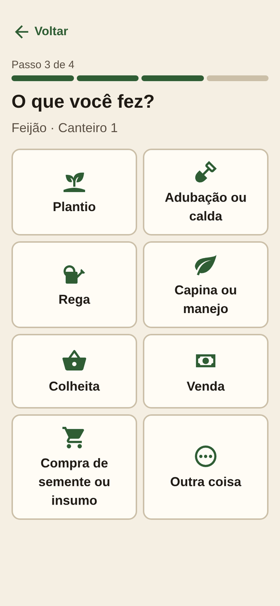
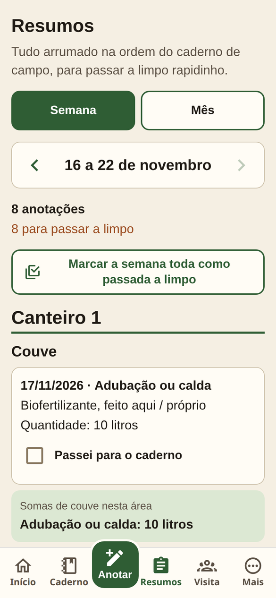
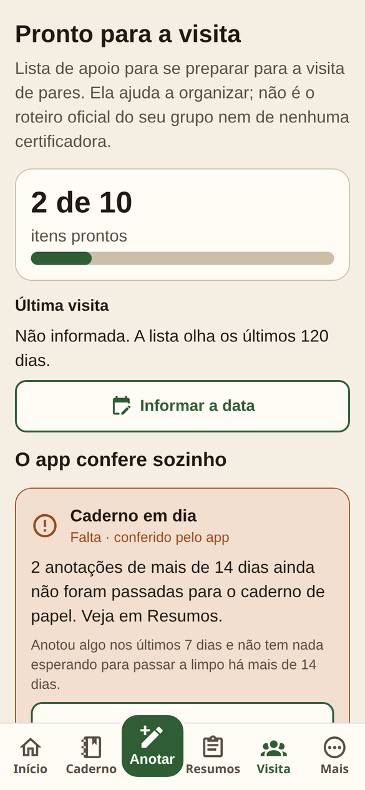

# Caderno de Bolso

App Android que deixa o agricultor agroecológico anotar a roça na hora, com poucos toques e sem internet, e devolve tudo organizado na ordem do caderno de campo, pronto para passar a limpo, para a visita de pares e para mostrar ao comprador.

<p>
  
  
  
  
</p>

## O problema

Agricultores familiares do Território de Irecê (BA), certificados como orgânicos por sistema participativo de garantia, plantam milho crioulo, feijão e hortaliças. Eles mantêm um caderno de campo em papel, conferido em visitas de pares três vezes por ano, e entregam uma declaração de transação ao comprador a cada venda.

Em entrevistas com esses produtores apareceram quatro dores:

- **Anotar duas vezes.** A anotação é feita na hora num papel solto ou no celular e depois copiada para o caderno. Há produtor que gasta de 5 a 6 horas por semana nisso.
- **Caderno que molha ou se perde.** O registro de anos fica numa única cópia de papel.
- **Provar a cada venda que é orgânico.** Hoje isso se resolve mostrando foto ou convidando o comprador para ir à roça.
- **Preparar a visita de pares.** Não há um jeito rápido de saber o que falta antes da visita.

Os entrevistados também deixaram claras as condições de uso: o sinal na roça é ruim, aplicativos anteriores foram abandonados por serem complicados, e o caderno de papel continua sendo o registro oficial.

## A solução

O Caderno de Bolso é um ajudante do caderno de campo, não um substituto. O produtor anota no momento em que faz o trabalho e, depois, copia para o papel a partir de um resumo que já vem na ordem certa.

### Anotar

- Passo a passo com uma escolha por tela: área, cultura, atividade e detalhes. Ao tocar numa opção, o app avança sozinho.
- Atividades: plantio (origem da semente), adubação ou calda (insumo e origem), rega, capina ou manejo, colheita, venda (valor e destino), compra de semente ou insumo, e outra.
- Quantidade num teclado numérico grande do próprio app, com unidade (kg, saca, caixa, maço, unidade, litro, carrinho de mão).
- Revisão em uma frase ("Hoje, no Canteiro 1: colheita de 12 kg de feijão"), com data (Hoje, Ontem ou Outro dia), observação curta, foto e **recado de voz** de até 60 segundos, que dá para ouvir, apagar e regravar antes de salvar.
- Confirmação "Anotado!" com vibração e botão **Desfazer**. O app lembra a última área e põe as culturas mais usadas no topo.

### Acompanhar

- **Caderno:** histórico por dia, com filtros por área, cultura e atividade. Dá para ouvir o recado, editar e apagar, com desfazer.
- **Resumos** semanal e mensal, agrupados por área e cultura na ordem dos campos do caderno de campo: data, área, cultura, atividade, insumo ou semente e origem, quantidade. Cada linha tem a caixa "Passei para o caderno", e o período inteiro pode ser marcado de uma vez. O resumo vira um PDF para compartilhar ou imprimir.
- **Colheita e venda:** por cultura, quanto colheu, vendeu e recebeu no período, com barras simples. O que sobrou é calculado de forma acumulada e só dentro da mesma unidade. Quilo nunca se soma com caixa.
- Editar uma anotação já passada a limpo faz ela voltar para "falta passar para o caderno".

### Visita de pares

- Lista de apoio com cinco itens conferidos automaticamente a partir das anotações: caderno em dia, origem das sementes (com destaque para milho e feijão), insumos com origem, colheitas anotadas e cópia de segurança recente. Cada item explica o que foi conferido e o que falta.
- Itens que o produtor marca: notas e recibos, declarações de transação, plano de manejo, separação de produto convencional e pendências da última visita.
- PDF "Resumo para a visita", com dados do produtor, a lista e as anotações desde a última visita.

### Ficha do produtor (QR)

- QR grande para o comprador ler com a câmera. Ele abre a ficha pública no site do projeto, com nome, município, cooperativa, certificação e culturas.
- Compartilhar o link e imprimir um cartão em PDF com o QR.

### Cópia de segurança

- Fotos das páginas do caderno de papel, organizadas por data e com legenda.
- **Exportar** gera um único arquivo `.zip` com todos os dados, as fotos e os recados de voz. **Importar** restaura tudo, inclusive num celular novo.

## Decisões de engenharia

**Offline primeiro.** Não há servidor, conta nem login. Tudo é gravado no aparelho e todas as funções rodam sem sinal. O único momento em que alguém precisa de internet é quando o comprador abre a ficha lida no QR.

**Anotar por seleção.** Digitar texto foi o que fez os produtores largarem aplicativos anteriores. Por isso a anotação é feita com toques, e só a quantidade é digitada. Uma colheita numa roça com uma área leva quatro toques além dos números.

**Pronto para sincronizar.** Todo registro tem id UUID estável, `updatedAt` e, quando apagado, `deletedAt`: apagar é um soft delete, e o registro continua guardado para que a exclusão possa ser propagada. Cada gravação passa por uma camada de repositório (`src/data/repository.ts`) que alimenta uma fila de alterações, com só a versão mais recente de cada registro. Os dados de exemplo nunca entram na fila. Os dados das versões anteriores do app são migrados automaticamente (`src/lib/migrate.ts`).

**Mídia por caminho relativo.** Fotos e áudios ficam na pasta de documentos do app. Os registros guardam só `anotacoes/…`, `caderno/…` ou `audios/…`, e o endereço completo é montado na hora de exibir. Assim a mídia sobrevive a atualizações do app e viaja na cópia de segurança. Ao editar ou apagar uma anotação, a foto e o recado antigos só saem do aparelho depois que o prazo do "Desfazer" passa.

**Lógica pura e testada.** Datas, resumos, saldo de colheita e venda, lista da visita, ficha do QR, migração, repositório, arquivo de cópia e HTML dos PDFs são funções puras em `src/lib` e `src/data`, sem dependência de tela. As telas só chamam essas funções. Os resumos apenas agrupam e somam o que foi anotado.

**Contrato da ficha no QR.** O QR codifica `${EXPO_PUBLIC_WEB_URL}/ficha/#d=<payload>`. O `payload` é o base64url, sem padding, dos bytes UTF-8 de um JSON compacto. Os dados vão no fragmento (`#`), então não passam por nenhum servidor. O contrato é versionado:

| chave | conteúdo |
| --- | --- |
| `v` | versão do formato (hoje `1`), obrigatória |
| `n` | nome do produtor, obrigatório |
| `m` | município |
| `c` | cooperativa ou núcleo |
| `o` | organismo de certificação (OPAC) |
| `ct` | identificação do certificado |
| `d` | certificado desde (ano) |
| `r` | registro no cadastro nacional de produtores orgânicos |
| `s` | código de outro sistema de rastreio |
| `cu` | culturas (até 12) |
| `u` | data da última anotação (AAAA-MM-DD) |

Chaves vazias são omitidas, e o QR usa correção de erro nível M. `encodeFicha` e `decodeFicha`, em `src/lib/ficha.ts`, são testadas com acentos e conferidas contra o `Buffer` do Node.

**Acessibilidade para pouca familiaridade digital:**

- Português do dia a dia ("roça", "canteiro", "passar a limpo"), sem termos técnicos.
- Alvos de toque de no mínimo 56 dp e letra base de 18.
- Fundo claro e texto escuro, com contraste pensado para leitura no sol.
- Todo ícone acompanhado de texto, e barra de passos e botão "Voltar" sempre visíveis.
- Tamanho de letra ajustável no app (normal, grande e muito grande), somado ao tamanho escolhido no sistema.
- `accessibilityLabel` e `accessibilityRole` em todos os controles.
- Cores, espaçamentos e tipografia definidos como tokens em `src/theme`.

## Stack

- Expo SDK 58, React Native 0.88, TypeScript estrito
- expo-router, com abas e pilha de telas
- zustand com persistência em AsyncStorage
- expo-audio para gravar e tocar recados, expo-image-picker para fotos, expo-file-system para arquivos
- expo-print e expo-sharing para os PDFs e o compartilhar, react-native-qrcode-svg para o QR
- fflate para o arquivo `.zip` da cópia de segurança
- Jest (jest-expo) e Testing Library, ESLint (eslint-config-expo)

## Arquitetura

```
src/
  app/                 telas (expo-router)
    (tabs)/            Início, Caderno, Anotar, Resumos, Visita, Mais
    anotar.tsx         passo a passo de anotar e editar
    boas-vindas.tsx    primeiro uso e dados de exemplo
    ficha.tsx          QR e cartão
    copia-seguranca.tsx, colheita-venda.tsx, perfil.tsx, areas-culturas.tsx, sobre.tsx, +not-found.tsx
  components/          interface reutilizável (opções grandes, teclado numérico, gravador de voz...)
  data/repository.ts   regras de gravação (upsert, soft delete) e fila de alterações
  lib/                 domínio em funções puras: datas, resumos, colheita, lista da visita,
                       ficha, mídia, migração, cópia de segurança, PDFs
  lib/device.ts        acesso ao aparelho: câmera, microfone, arquivos, PDF, compartilhar
  store/               estado do app e persistência
  theme/               tokens visuais
```

O fluxo de dados vai numa direção só: a tela chama uma ação do `store`, o `store` aplica as regras do repositório e registra a alteração na fila, e as telas leem os registros ativos com `useEntries`, `useAreas` e `usePhotos`.

## Como rodar

Requisitos: Node 20 ou mais novo e Android Studio (SDK e emulador) ou um celular Android com depuração USB.

```bash
npm install
npx expo run:android      # compila o app nativo e abre no emulador ou no celular
```

O app usa módulos nativos (microfone, câmera, arquivos), então roda como build de desenvolvimento, não no Expo Go. Depois da primeira compilação, `npx expo start` basta para recarregar o código.

Na primeira abertura, "Ver com dados de exemplo" carrega um produtor fictício com três semanas de anotações.

### Gerar o APK

```bash
npx expo prebuild --platform android --clean
cd android && ./gradlew assembleRelease
```

O APK sai em `android/app/build/outputs/apk/release/app-release.apk`.

### Endereço do site da ficha

O QR aponta para `EXPO_PUBLIC_WEB_URL`, por padrão `https://andessonreis.github.io/caderno-de-bolso-web`. Para trocar, copie `.env.example` para `.env` e ajuste o valor.

## Testes

```bash
npm test             # Jest
npm run typecheck    # tsc --noEmit
npm run lint         # ESLint
npx expo-doctor      # dependências e configuração
```

Os testes de domínio cobrem datas, somas sem misturar unidades, saldo acumulado, lista da visita, ficha (ida e volta com acentos), migração de dados antigos, repositório e fila de alterações, e o arquivo `.zip` de cópia (ida e volta com fotos e áudios, rejeição de arquivos inválidos e de caminhos fora das pastas do app).

Os testes de tela abrem cada rota com os dados de exemplo e percorrem o fluxo completo de anotar por toques, salvar e desfazer. Também cobrem a edição de uma anotação já passada a limpo e a troca da data da visita.

## Próximos passos

- **Sincronização online**, opcional e por conta, usando a fila de alterações e os ids estáveis que o app já mantém, para ter o caderno em mais de um aparelho e uma cópia fora do celular.
- **Painel do grupo**, para o núcleo ou a cooperativa acompanhar, com autorização do produtor, quem está com o caderno em dia antes das visitas.
- **Declaração de transação** gerada a partir de uma venda anotada.
- **Testes de campo** com os produtores entrevistados, para ajustar textos e fluxos ao uso real na roça.
