# Fluxos por tela

Este documento descreve, tela por tela, o que o produtor vê, o que pode fazer e para onde cada ação leva. Ele foi escrito a partir das rotas do app (`src/app`). Se algum ponto divergir do app, vale o app.

As capturas estão em [`docs/telas/`](telas/README.md), numeradas na ordem de uso e com um índice que diz como chegar em cada tela. Foram feitas com o app renderizado em tamanho de celular (390 × 844) e um produtor fictício. As telas "Cópia na internet" e "Já tenho um caderno" só existem no app instalado; as capturas delas usam um servidor simulado, e o código que aparece nelas não abre nenhum caderno.

## Mapa geral de navegação

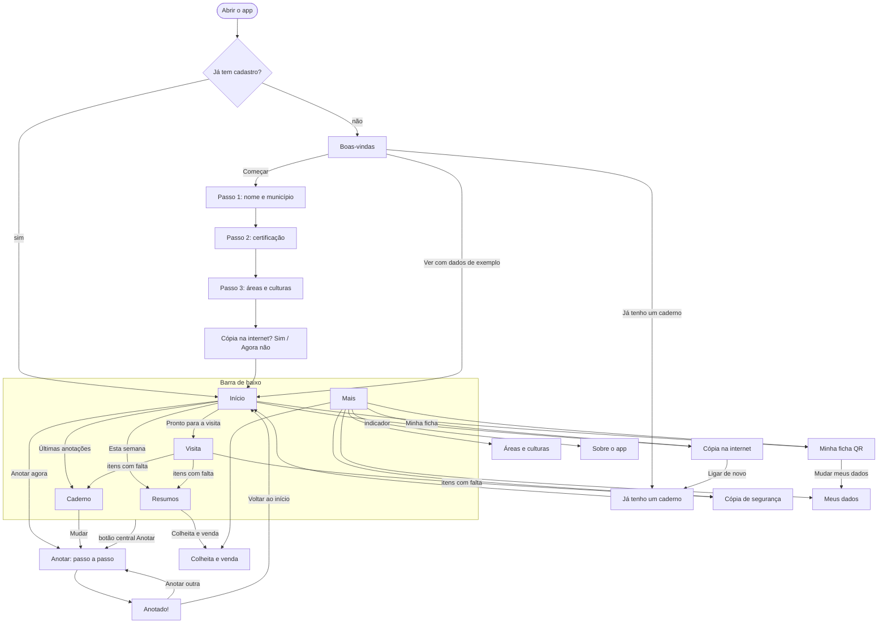

## Fluxo principal: da roça à venda

Este é o caminho que resolve a principal dor dos produtores: anotar na hora, passar a limpo sem precisar reescrever tudo e provar a origem na venda.

```mermaid
flowchart LR
    A([Na roça, depois do trabalho]) --> B[Anotar: área]
    B --> C[cultura]
    C --> D[o que fez]
    D --> E[detalhes e quantidade]
    E --> F[Confira e salve]
    F --> G([Anotado!])
    G --> H[Resumos: semana na ordem do caderno]
    H --> I[Copiar para o caderno de papel]
    I --> J[Marcar Passei para o caderno]
    J --> K([Caderno em dia])
    K --> L[Na venda: Minha ficha]
    L --> M[Comprador aponta a câmera para o QR]
    M --> N([Comprador vê quem produziu])
```

## Primeiro uso

### Boas-vindas

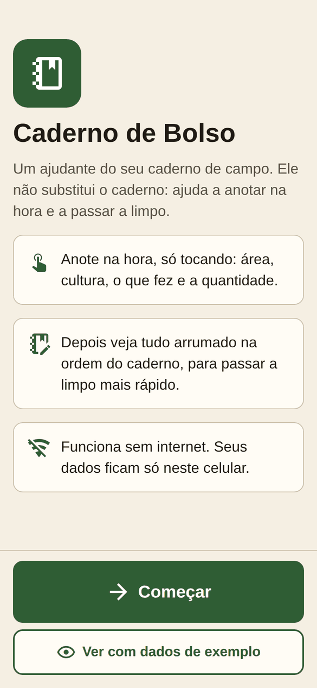

Você chega aqui na primeira vez que abre o app, ou depois de apagar os dados de exemplo quando eles eram o único cadastro. A tela mostra o nome do app, uma frase dizendo que ele ajuda o caderno de campo sem substituí-lo, e três lembretes: anotar só tocando, ver tudo na ordem do caderno e funcionar sem internet.

- **Começar** leva ao passo 1 do cadastro.
- **Ver com dados de exemplo** carrega um produtor fictício, Zé Carlos, de Canarana-BA, com cerca de três semanas de anotações, e vai direto para o Início. Serve para conhecer o app sem cadastrar nada.
- **Já tenho um caderno** (só no celular) leva à tela de ligar este celular a um caderno guardado na internet.

Funciona sem internet, menos o "Já tenho um caderno".

### Passo 1: Quem é você?

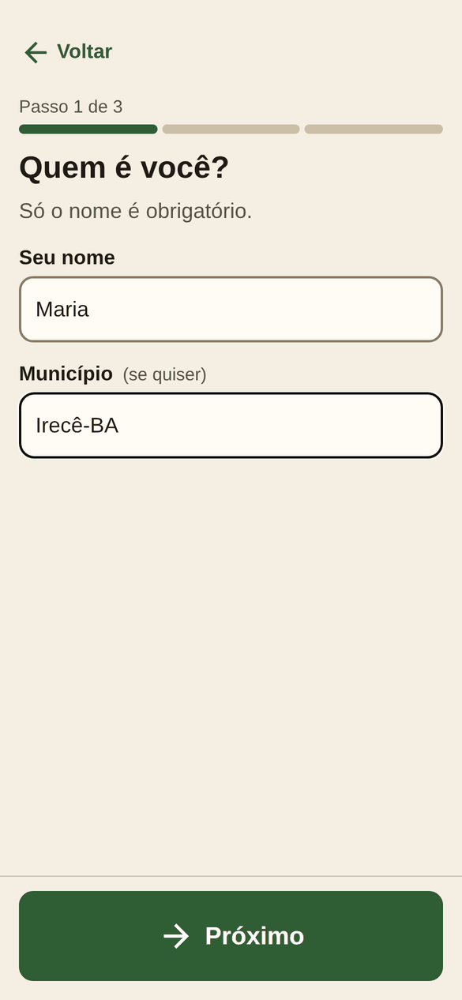

A barra mostra "Passo 1 de 3". O app pede o **nome**, que é obrigatório, e o **município**, que é opcional. O botão **Próximo** só funciona com o nome preenchido. **Voltar** retorna às boas-vindas.

### Passo 2: Sua certificação

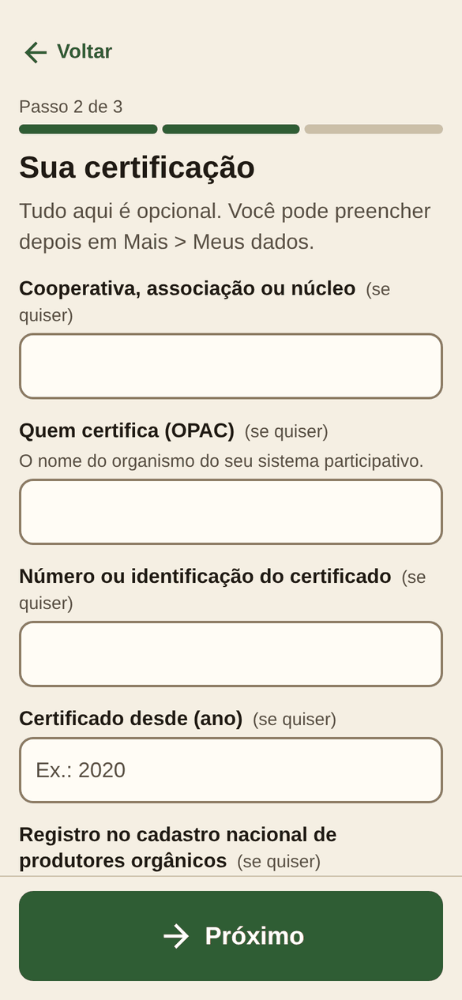

Todos os campos são opcionais: cooperativa ou núcleo, quem certifica (OPAC), número do certificado, ano desde quando é certificado e registro no cadastro nacional de produtores orgânicos. Se o ano não fizer sentido (antes de 1980 ou no futuro), aparece "O ano do certificado parece errado." e o **Próximo** fica bloqueado. Tudo pode ser preenchido depois, em Mais > Meus dados.

### Passo 3: Sua roça

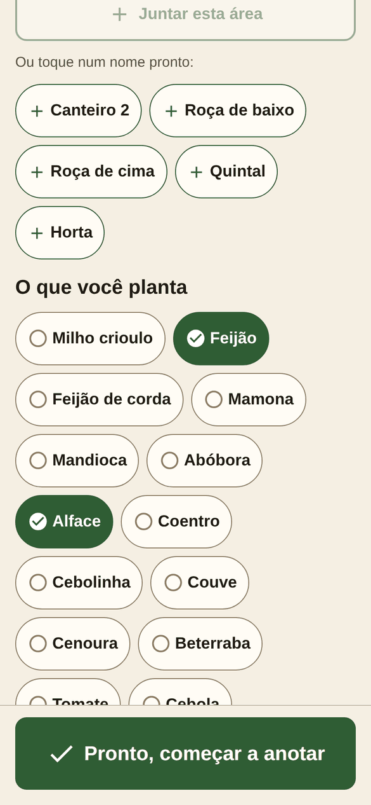

Aqui o produtor cadastra as **áreas** e marca as **culturas** que planta. Para concluir, é obrigatório ter pelo menos uma área e uma cultura.

- **Áreas:** dá para digitar um nome curto e tocar em **Juntar esta área**, ou tocar num nome pronto (Canteiro 1, Roça de baixo, Quintal...). Cada área tem **Mudar** (renomear) e **Tirar**. Um nome repetido é avisado.
- **Culturas:** tocar marca ou desmarca cada uma de uma lista pronta (milho crioulo, feijão, alface, coentro...). "Outra cultura" serve para digitar uma que não está na lista.

O botão **Pronto, começar a anotar** só funciona com o mínimo preenchido. Até lá, a tela diz o que falta.

### Cópia na internet (pergunta do primeiro uso)

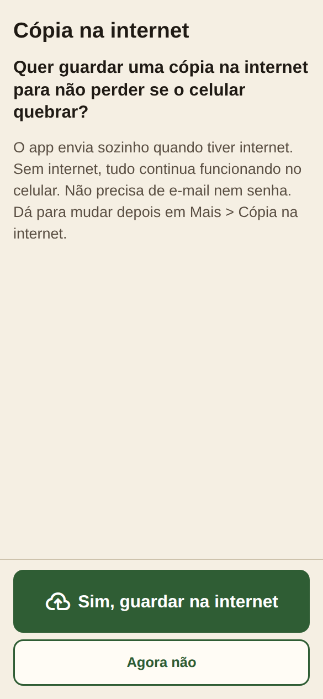

Só no celular, logo depois do passo 3. A tela pergunta: "Quer guardar uma cópia na internet para não perder se o celular quebrar?"

- **Sim, guardar na internet** liga a cópia e vai para o Início. Se não houver internet nessa hora, a cópia fica pendente e começa sozinha quando o sinal voltar.
- **Agora não** vai para o Início. Dá para ligar depois em Mais > Cópia na internet.

## Barra de baixo (abas)

Sempre visível nas telas principais: **Início**, **Caderno**, **Anotar** (botão central maior, em destaque), **Resumos**, **Visita** e **Mais**. Todo ícone vem com nome. O botão Anotar abre o passo a passo de anotar por cima da tela atual.

## Início

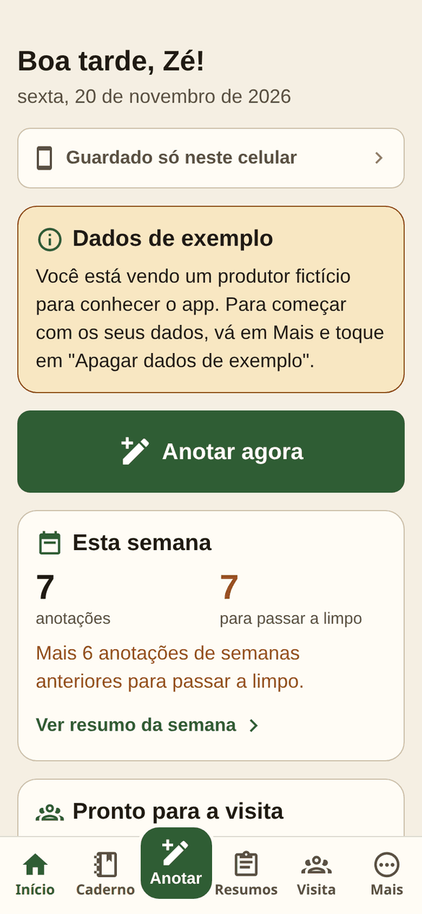

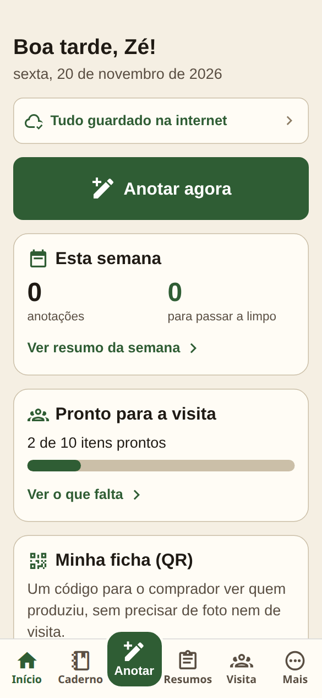

Você chega aqui ao abrir o app, ao concluir o cadastro ou pela aba Início. A tela mostra:

- **Saudação** com o primeiro nome ("Bom dia, Zé!") e a data de hoje.
- **Indicador da cópia:** uma linha com "Tudo guardado na internet", "Sem internet: guardado só no celular, envio depois", "Enviando…", "Faltam N para enviar" ou "Guardado só neste celular". Tocar leva à tela Cópia na internet.
- **Dados de exemplo:** um aviso que aparece só quando o produtor fictício está carregado e explica como apagá-lo.
- **Anotar agora:** o botão maior da tela, que abre o passo a passo de anotar.
- **Esta semana:** quantas anotações houve na semana e quantas faltam passar a limpo, mais as pendentes de semanas anteriores. Tocar leva aos Resumos.
- **Pronto para a visita:** quantos itens da lista estão prontos ("2 de 10"), com barra de progresso. Tocar leva à Visita.
- **Minha ficha (QR):** leva à ficha para mostrar ao comprador.
- **Últimas anotações:** as três mais recentes, em frase. Tocar abre o Caderno.

Tudo funciona sem internet.

## Anotar (passo a passo)

Você chega aqui pelo botão **Anotar agora** do Início, pelo botão central da barra de baixo ou por **Mudar** numa anotação do Caderno. Cada tela pede uma decisão só e mostra "Passo X de Y". Ao tocar numa opção, o app já passa para a próxima tela. **Voltar** volta um passo; no primeiro passo o botão se chama **Sair** e fecha o fluxo. O botão voltar do Android também volta um passo.

### Onde foi? (área)

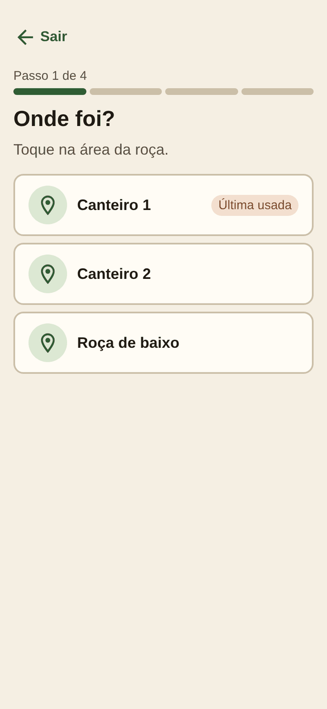

Mostra as áreas cadastradas, com a última usada no topo e a etiqueta "Última usada". Se a roça tem uma área só, este passo é pulado.

### Qual cultura?

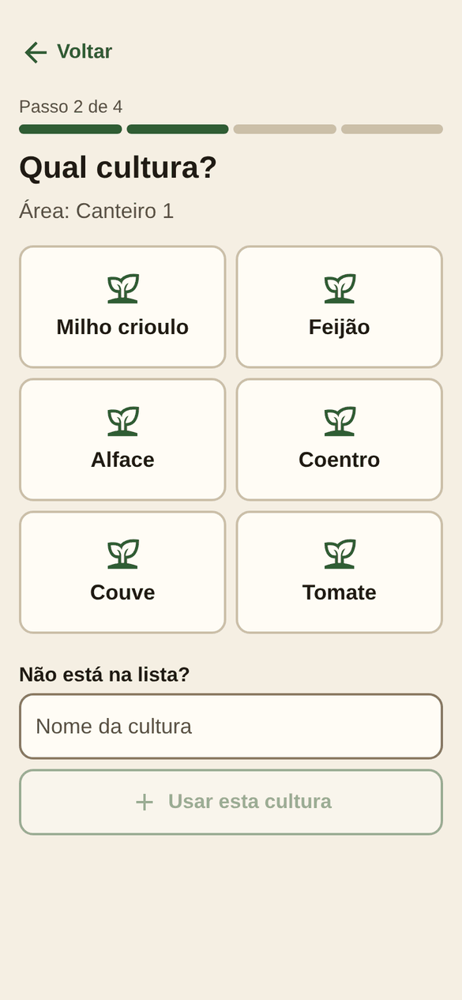

Mostra as culturas em blocos grandes, com as mais usadas primeiro. Em "Não está na lista?" dá para digitar uma cultura nova e tocar em **Usar esta cultura**. Ela também passa a fazer parte da lista do produtor.

### O que você fez?

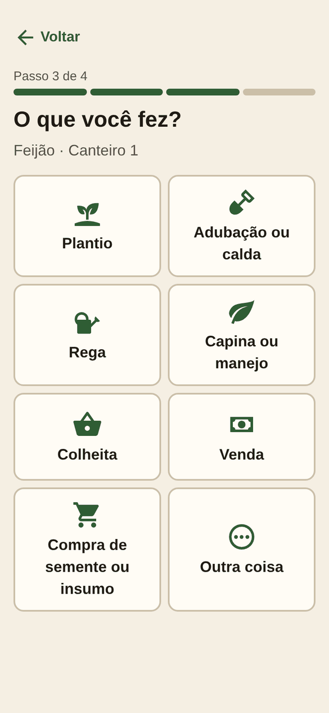

Oito opções: Plantio, Adubação ou calda, Rega, Capina ou manejo, Colheita, Venda, Compra de semente ou insumo e Outra coisa. A escolha define os próximos passos:

| Atividade | Passos seguintes |
| --- | --- |
| Plantio | De onde veio a semente? (Semente própria, Troca com vizinho, Banco de sementes, Comprada com nota; dá para pular) → Quanto? (opcional) |
| Adubação ou calda | O que usou? (esterco, composto, biofertilizante, calda bordalesa, calda sulfocálcica, outro) → De onde veio? (feito aqui ou comprado) → Quanto? (opcional) |
| Colheita | Quanto? (obrigatório) |
| Venda | Quanto? (obrigatório) → Quanto recebeu? (opcional) → Vendeu para onde? (feira, cooperativa, venda direta, compra pública, outro; opcional) |
| Compra | O que comprou? (semente ou muda; adubo, calda ou insumo) → Quanto? (opcional) → Quanto pagou? (opcional) |
| Rega, Capina ou manejo, Outra coisa | vão direto para a revisão |

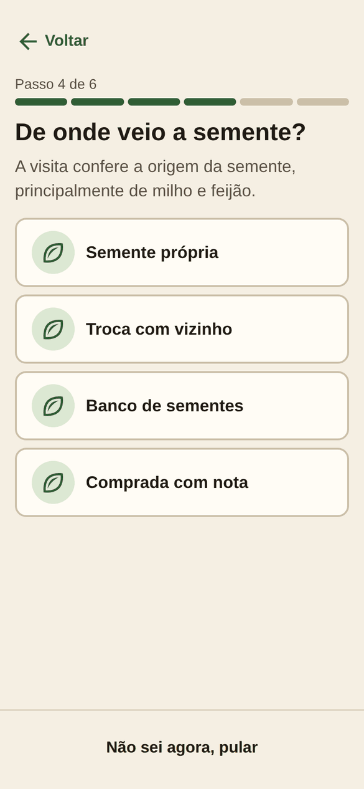

### Quanto?

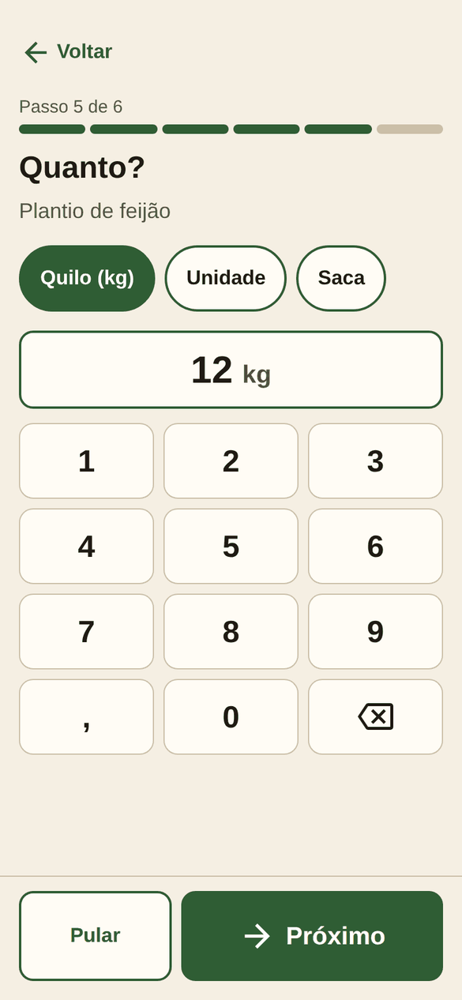

Primeiro escolhe-se a unidade (quilo, saca, caixa, maço, unidade, litro, carrinho de mão, conforme a atividade). O app já marca a unidade usada da última vez para aquela cultura e atividade. Depois o produtor digita a quantidade num teclado numérico grande do próprio app, com vírgula e botão de apagar. **Próximo** só funciona com um número válido. Nas atividades em que a quantidade é opcional, aparece também **Pular**.

### Confira e salve

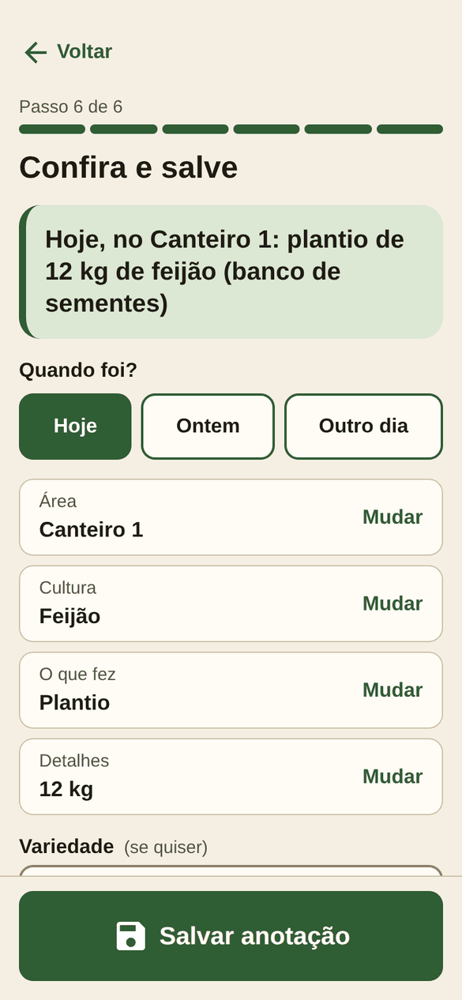

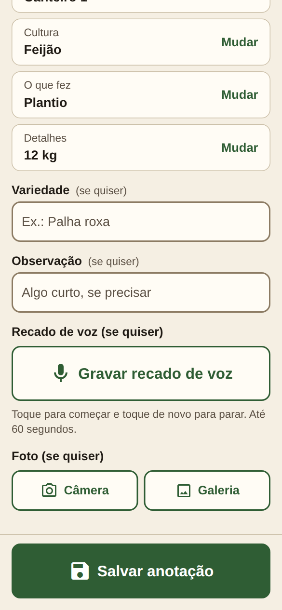

A anotação aparece numa frase ("Hoje, no Canteiro 1: plantio de 12 kg de feijão (banco de sementes)"). Nesta tela:

- **Quando foi?** tem Hoje, Ontem ou Outro dia. "Outro dia" mostra setas para voltar ou avançar um dia, nunca além de hoje.
- **Área, Cultura, O que fez e Detalhes** têm um **Mudar** que leva ao passo correspondente e volta para a revisão.
- **Variedade** (só no plantio) e **Observação** são campos curtos e opcionais.
- **Recado de voz** (opcional): "Gravar recado de voz" começa a gravar e mostra o cronômetro, com limite de 60 segundos. "Parar e guardar" encerra. Depois dá para ouvir, regravar ou apagar. Sem permissão do microfone, o app avisa como liberar.
- **Foto** (opcional): Câmera ou Galeria. A foto é reduzida para ocupar pouco espaço e pode ser tirada da anotação.
- **Salvar anotação** fica bloqueado só se faltar a quantidade numa colheita ou venda.

### Anotado!

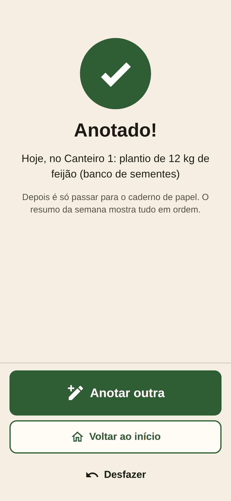

Confirmação com vibração, a frase da anotação e o lembrete de passar para o caderno de papel. Opções:

- **Anotar outra** recomeça o passo a passo na mesma área.
- **Voltar ao início** vai para o Início.
- **Desfazer** apaga a anotação recém-salva e volta para a revisão com tudo preenchido.

Ao editar uma anotação que vem do Caderno, o título é "Alteração salva!" e o botão é **Voltar ao caderno**. Nesse caso, **Desfazer** devolve a anotação como estava, inclusive a foto e o recado. Se a anotação já estava passada a limpo e algo do caderno mudou, aparece uma linha avisando que ela voltou para "falta passar para o caderno".

Anotar funciona sempre sem internet.

## Caderno

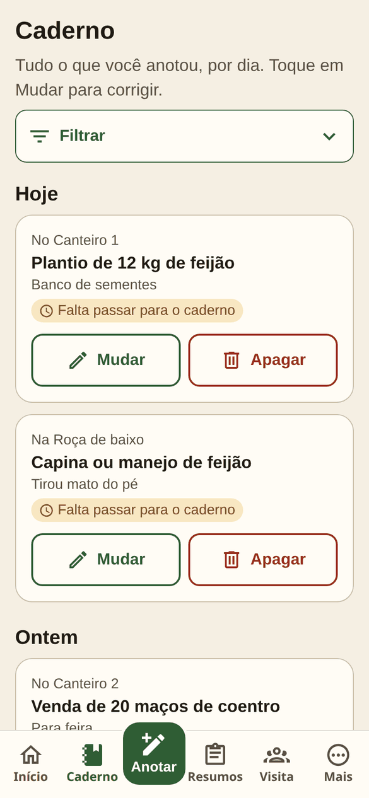

Você chega aqui pela aba Caderno, pelo cartão "Últimas anotações" do Início ou pela Visita. A tela lista tudo o que foi anotado, separado por dia ("Hoje", "Ontem", "segunda, 16 de novembro"). Cada anotação mostra:

- a área, a frase do que foi feito e os detalhes;
- a etiqueta "Passada para o caderno" ou "Falta passar para o caderno";
- a foto, quando houver, e o botão **Ouvir recado de voz**, quando houver;
- **Mudar**, que abre a anotação no passo a passo, já na revisão;
- **Apagar**, que pede confirmação e depois mostra "Anotação apagada." com **Desfazer** por alguns segundos.

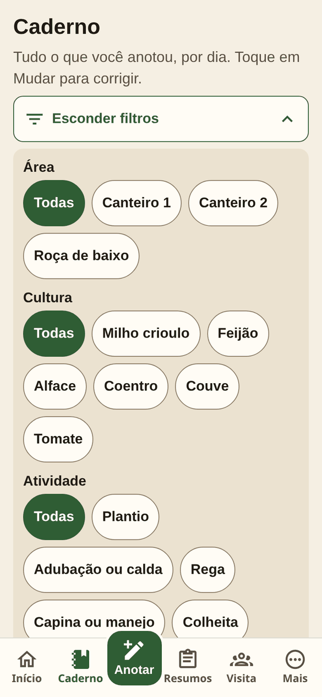

**Filtrar** abre filtros por área, cultura e atividade, e mostra quantos estão ligados. **Limpar filtros** volta a mostrar tudo.

Estados vazios:

- Sem nenhuma anotação: "O caderno está vazio", com o botão "Fazer a primeira anotação".
- Com filtros que não encontram nada: "Nada com esses filtros", com "Limpar filtros".

Funciona sem internet.

## Resumos

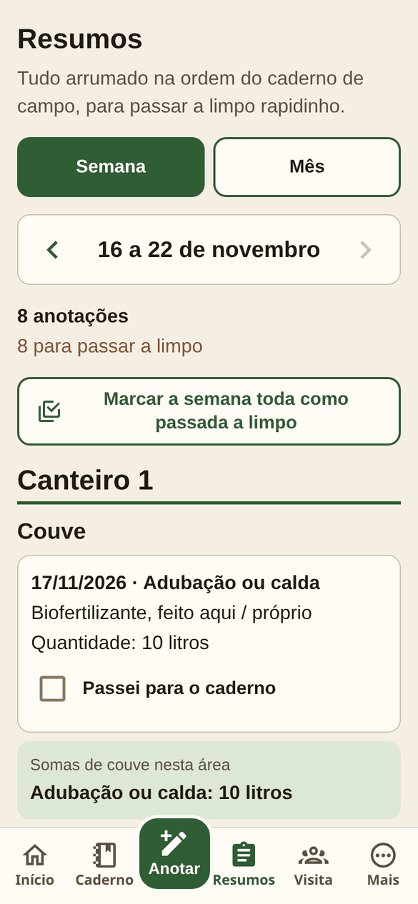

Você chega aqui pela aba Resumos ou pelo cartão "Esta semana" do Início. No topo, a escolha entre **Semana** e **Mês** e as setas para o período anterior ou o próximo (não passa do período atual). A tela mostra:

- o total de anotações do período e quantas faltam passar a limpo;
- **Marcar a semana toda como passada a limpo** (ou o mês todo);
- as anotações agrupadas por **área** e por **cultura**, na ordem dos campos do caderno de campo: data e atividade, insumo ou semente e origem, quantidade, e valor, destino ou observação;
- em cada linha, a caixa **Passei para o caderno**;
- as **somas** de cada cultura por atividade e unidade. Unidades diferentes nunca se somam;
- **Compartilhar / Imprimir**, que gera um PDF limpo do período para enviar pelo WhatsApp, salvar ou imprimir;
- **Desmarcar** o período todo, quando tudo já foi passado a limpo;
- o cartão **Colheita e venda**, que abre a tela de mesmo nome.

Quando o período não tem anotação: "Nada anotado neste período", com o botão "Anotar agora".

Funciona sem internet.

## Colheita e venda

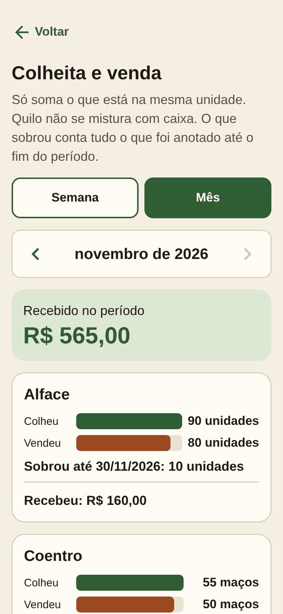

Você chega aqui pelo cartão nos Resumos ou por Mais. A tela tem Semana ou Mês, com setas, e mostra:

- o **total recebido** no período;
- para cada cultura: barras de **Colheu** e **Vendeu** em cada unidade, **Recebeu** (soma dos valores de venda) e quantas vendas ficaram sem valor;
- **Sobrou até o fim do período**: toda colheita menos toda venda anotadas até ali, na mesma unidade. Se a venda passar da colheita somando tudo, o app avisa e sugere conferir se falta anotar alguma colheita. Se a unidade vendida nunca teve colheita anotada, o app diz que não há como comparar.

Sem colheita nem venda no período: a tela explica e oferece "Anotar agora".

Funciona sem internet.

## Visita (Pronto para a visita)

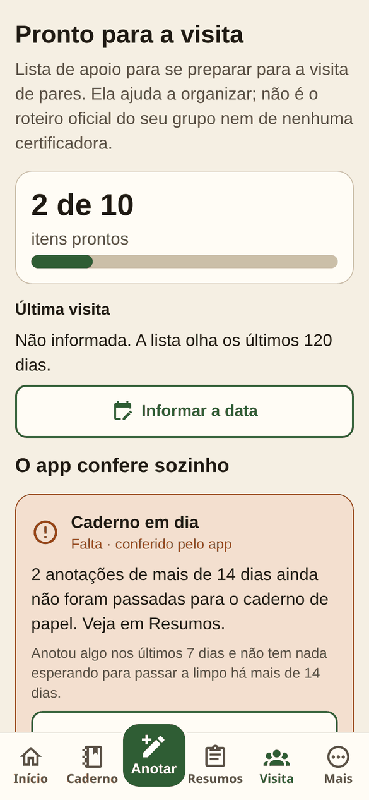

Você chega aqui pela aba Visita ou pelo cartão do Início. A tela diz que é uma **lista de apoio** e que não é o roteiro oficial de nenhum grupo ou certificadora. Ela mostra:

- **Progresso:** "2 de 10 itens prontos", com barra.
- **Última visita:** a data informada, ou "Não informada", e nesse caso a lista olha os últimos 120 dias. **Informar a data** ou **Mudar a data** mostra botões para voltar ou avançar dias, semanas e meses. "Não lembro a data" limpa a data. Se a data muda e há itens marcados à mão, o app pergunta se quer desmarcá-los, porque eram da visita anterior.
- **O app confere sozinho:** caderno em dia, origem das sementes (com alerta para milho e feijão), adubos e caldas com origem, colheitas anotadas e cópia de segurança nos últimos 30 dias. Cada item mostra "Pronto" ou "Falta", explica o porquê e, quando falta, tem um botão que leva aonde resolver: Abrir resumos, Abrir o caderno, Anotar agora ou Fazer cópia de segurança.
- **Você marca:** notas fiscais e recibos, declarações de transação, plano de manejo, armazenamento e transporte separados, e pendências da última visita.
- **Compartilhar resumo para a visita:** um PDF com os dados do produtor, a lista e as anotações desde a última visita.

Funciona sem internet.

## Mais

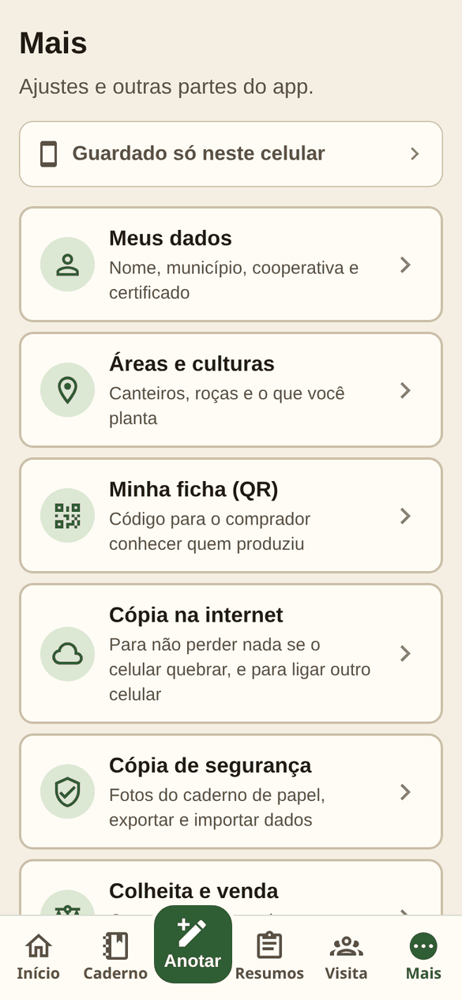

Você chega aqui pela aba Mais. A tela mostra o indicador da cópia na internet e o menu:

- **Meus dados** leva à tela de perfil.
- **Áreas e culturas** leva à tela de mesmo nome.
- **Minha ficha (QR)** leva à ficha.
- **Cópia na internet** leva à tela da cópia na internet.
- **Cópia de segurança** leva às fotos do caderno e ao exportar e importar.
- **Colheita e venda** leva à tela de mesmo nome.
- **Sobre o app** leva à tela Sobre.

Abaixo do menu:

- **Tamanho da letra:** Normal, Grande ou Muito grande. Muda a letra de todo o app na hora.
- **Dados de exemplo:** aparece só com o exemplo carregado. "Apagar dados de exemplo" pede confirmação e tira o produtor fictício e as anotações de exemplo. O que o produtor anotou continua, mesmo numa área de exemplo. Se o perfil também era de exemplo, o app volta para as boas-vindas.

## Meus dados

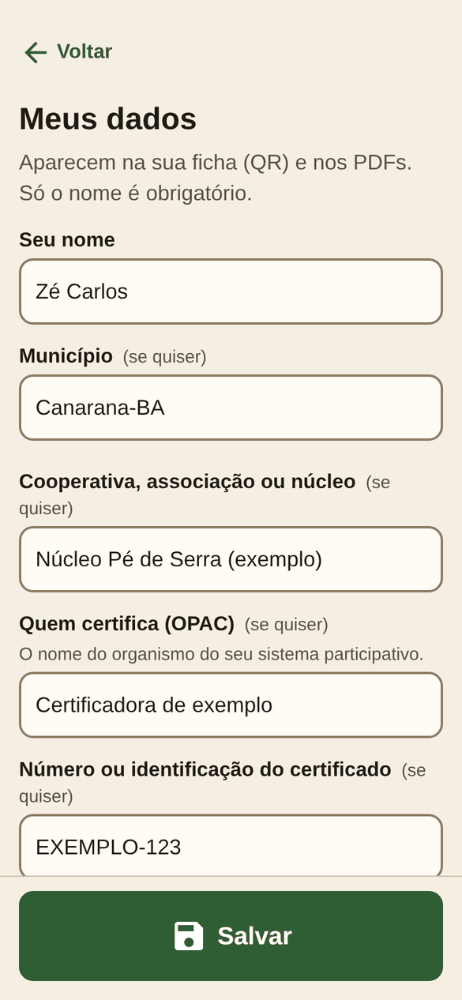

Você chega aqui por Mais ou por "Mudar meus dados" na ficha. A tela traz os mesmos campos do cadastro (nome, município, cooperativa, OPAC, certificado, ano, registro nacional), mais o **código do sistema de rastreio que já uso**, que entra na ficha. Só o nome é obrigatório. Os campos têm limite de tamanho igual ao do site da ficha. **Salvar** grava e volta; com o nome vazio ou o ano errado, o app avisa e não salva.

## Áreas e culturas

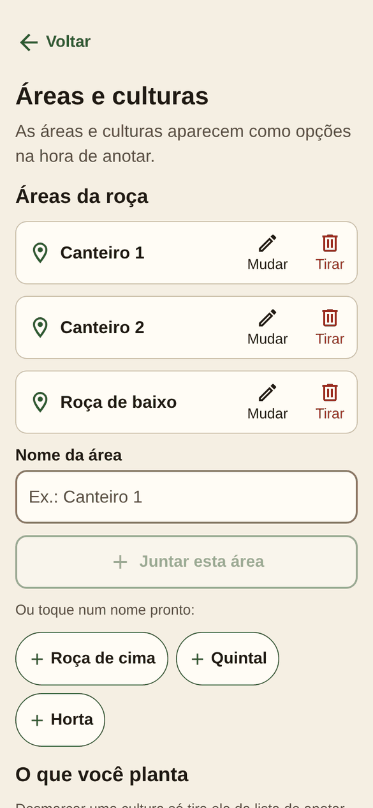

Você chega aqui por Mais. A tela permite:

- **juntar, renomear e tirar áreas.** Uma área com anotações não pode ser tirada, para não perder o histórico, e o app explica isso e sugere mudar o nome;
- **marcar e desmarcar culturas.** Desmarcar só tira a cultura da lista de anotar; as anotações antigas continuam.

## Minha ficha (QR)

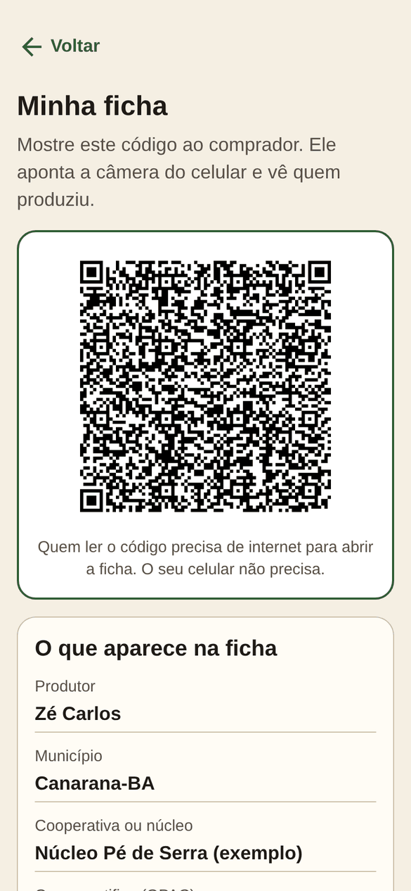

Você chega aqui pelo Início ou por Mais. A tela mostra:

- um **QR grande**, que o comprador lê com a câmera do celular. Ele abre a ficha do produtor no site do projeto;
- **O que aparece na ficha:** nome, município, cooperativa, OPAC, certificado, ano, registro nacional, código de rastreio, culturas e data da última anotação. Fotos e anotações não vão na ficha;
- **Mudar meus dados**, que leva à tela Meus dados;
- **Compartilhar link**, que manda o endereço da ficha pelo WhatsApp ou outro app;
- **Imprimir cartão** e **Cartão em PDF**, um cartão com o QR, o nome, a cooperativa e a frase "Aponte a câmera do celular para conhecer quem produziu".

Se os dados ficarem grandes demais para o QR, a tela avisa e pede para encurtar algum campo. O QR é mostrado sem internet. Quem lê precisa de internet para abrir a ficha.

## Cópia de segurança

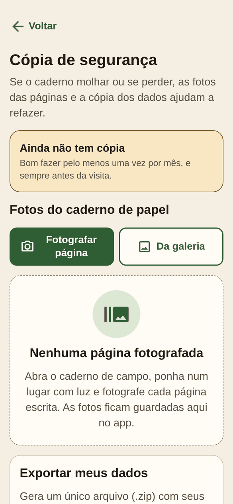

Você chega aqui por Mais ou pela Visita, no item "Cópia de segurança". A tela mostra:

- a **última cópia** ("Última cópia: hoje") ou "Ainda não tem cópia";
- **Fotos do caderno de papel:** **Fotografar página** ou **Da galeria**, com as fotos agrupadas por dia. Tocar numa foto abre em tela cheia, com legenda, **Salvar legenda**, **Apagar foto** (com confirmação) e **Fechar**. Sem fotos, a tela explica como fotografar as páginas;
- **Exportar meus dados**, que gera um único arquivo `.zip` com dados, anotações, fotos e recados de voz e abre o compartilhar;
- **Importar arquivo**, que pede confirmação (os dados do app são trocados pelos do arquivo) e restaura tudo, inclusive as fotos e os recados. Um arquivo que não é do app ou que está com problema gera uma mensagem, sem travar. Arquivos `.json` exportados por versões anteriores também são aceitos.

Funciona sem internet. O arquivo pode ser guardado no WhatsApp, no e-mail ou num pen drive.

## Cópia na internet

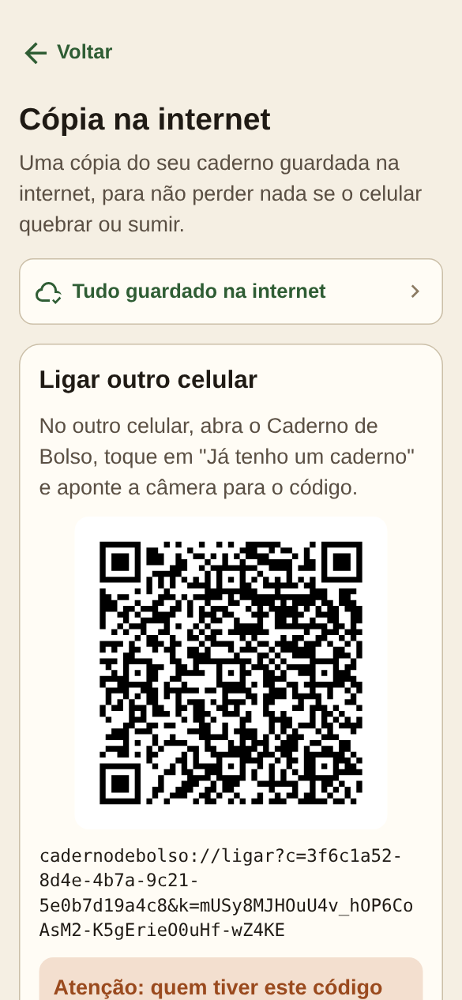

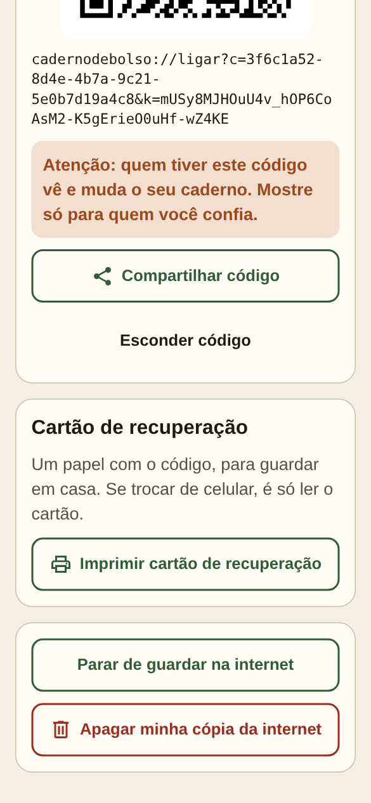

Só no app do celular. Você chega aqui por Mais, pelo indicador do Início ou de Mais, ou pela pergunta do primeiro uso.

- **Desligada:** a tela pergunta "Quer guardar uma cópia na internet para não perder se o celular quebrar?", explica que não precisa de e-mail nem senha e que tudo continua funcionando sem sinal, e oferece **Sim, guardar na internet** e **Agora não**.
- **Ligada:** o indicador mostra o estado do envio. Abaixo aparecem:
  - **Ligar outro celular:** "Mostrar código para ligar" mostra um QR e o código em texto, com o aviso de que quem tiver o código vê e muda o caderno. Há também "Compartilhar código" e "Esconder código". Se a cópia ainda não foi criada por falta de internet, a tela avisa;
  - **Imprimir cartão de recuperação:** um papel com o QR para guardar em casa;
  - **Parar de guardar na internet:** pede confirmação. As próximas anotações ficam só no celular, e a cópia que já está na internet continua lá;
  - **Apagar minha cópia da internet:** pede confirmação duas vezes e apaga anotações, fotos e recados da internet. O que está no celular continua.
- **Ligação perdida:** se a chave deixar de conferir, a tela diz que os dados continuam no celular e oferece **Ligar de novo**.
- **Com dados de exemplo:** a tela explica que o exemplo não vai para a internet.

O envio é automático: ao abrir o app, quando a internet volta, quando o app volta para a frente e alguns segundos depois de salvar algo. Sem internet, nada trava. Os envios esperam e são feitos depois.

## Já tenho um caderno (ligar este celular)

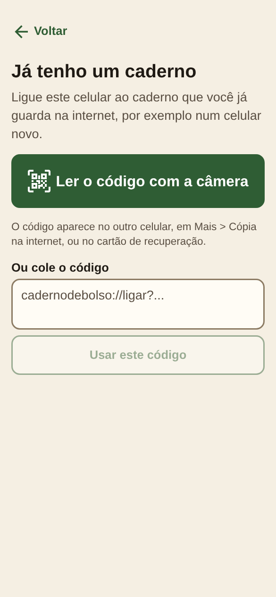

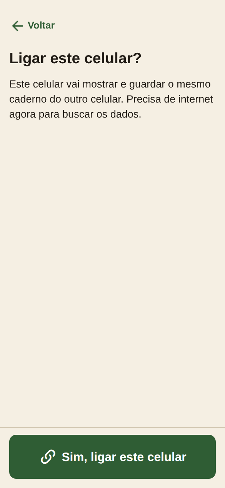

Só no app do celular. Você chega aqui pelas boas-vindas ("Já tenho um caderno"), pela Cópia na internet ("Ligar de novo") ou abrindo o link `cadernodebolso://ligar?...`.

1. **Escolher:** **Ler o código com a câmera** pede a permissão da câmera; se ela for negada, o app explica como liberar ou sugere colar o código. Também dá para colar o código no campo e tocar em **Usar este código**. Um código errado gera a mensagem "Esse código não é de um Caderno de Bolso".
2. **Confirmar:** "Ligar este celular?" explica que o celular vai mostrar o mesmo caderno e que precisa de internet agora. Se o celular já tem anotações, avisa que elas serão juntadas. O botão é **Sim, ligar este celular**. Quem chega pelo link vai direto para esta etapa.
3. **Ligando:** "Buscando seu caderno na internet".
4. **Pronto:** **Abrir o caderno** vai para o Início, ou para o cadastro se o caderno ligado ainda não tinha dados.

Se o código não confere, a tela pede o código de novo. Se não há internet, pede para tentar quando tiver sinal. Em nenhum desses casos o app apaga dados do celular.

## Sobre o app

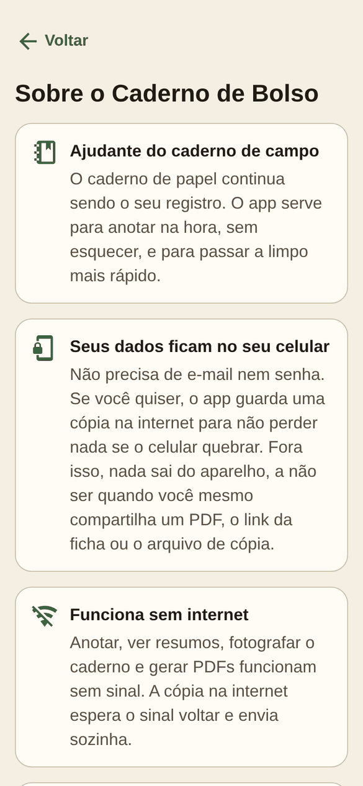

Você chega aqui por Mais. A tela explica que o app é um ajudante do caderno de campo, que os dados ficam no celular (e na cópia na internet, se o produtor quiser), que anotar e consultar funcionam sem internet, que os resumos só somam e que o app é um projeto acadêmico do IFBA campus Irecê.

## Página não encontrada

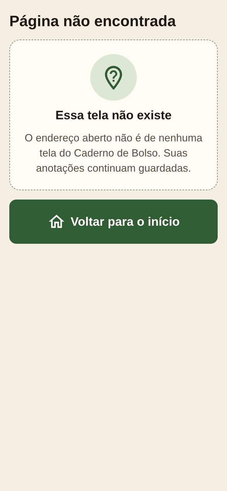

Aparece se um link aberto não corresponde a nenhuma tela. Explica que as anotações continuam guardadas e oferece **Voltar para o início**.

## Online e offline

| Funciona sem internet | Usa internet |
| --- | --- |
| Cadastro e dados de exemplo | Guardar a cópia na internet (o envio espera o sinal voltar) |
| Anotar, com foto e recado de voz | Ligar outro celular e "Já tenho um caderno" |
| Caderno, filtros, editar e apagar | Apagar a cópia da internet |
| Resumos, PDF, compartilhar e imprimir | O comprador abrir a ficha lida no QR |
| Colheita e venda | |
| Lista da visita e PDF da visita | |
| Mostrar o QR da ficha e o cartão | |
| Fotos do caderno, exportar e importar o `.zip` | |
| Tamanho da letra, perfil, áreas e culturas | |

Quando a cópia na internet está ligada e falta sinal, o indicador diz "Sem internet: guardado só no celular, envio depois". Quando o sinal volta, o app envia sozinho.

## Telas e as dores que atendem

| Tela | Dor ou ganho |
| --- | --- |
| Anotar | Anotar duas vezes; horas com anotações |
| Anotado! (com desfazer) | Horas com anotações (corrigir sem recomeçar) |
| Caderno | Usar as anotações para gerir a produção |
| Resumos | Anotar duas vezes; horas com anotações; estar pronto para a visita |
| Colheita e venda | Usar as anotações para gerir a produção |
| Visita | Estar pronto para a visita |
| Minha ficha (QR) | Provar a cada venda que é orgânico; comprador conferir sozinho |
| Cópia de segurança | Caderno que se perde ou molha |
| Cópia na internet e Já tenho um caderno | Caderno que se perde ou molha |
| Início | Estar pronto para a visita; horas com anotações (vê o que falta num relance) |
| Boas-vindas e dados de exemplo | Conhecer o app sem cadastrar nada |
