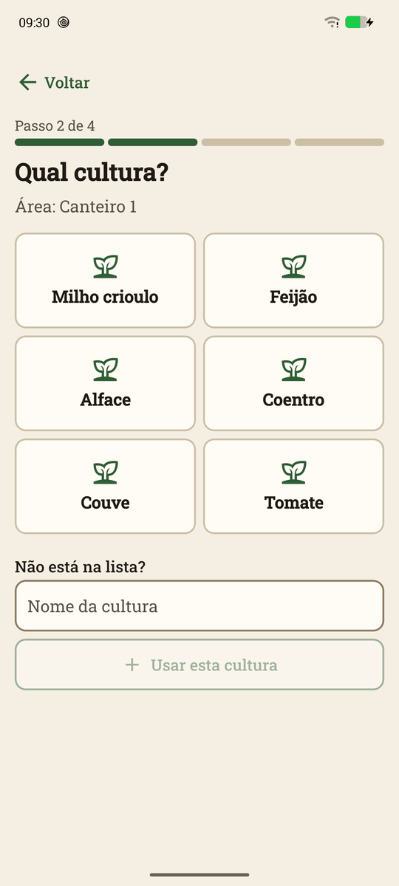
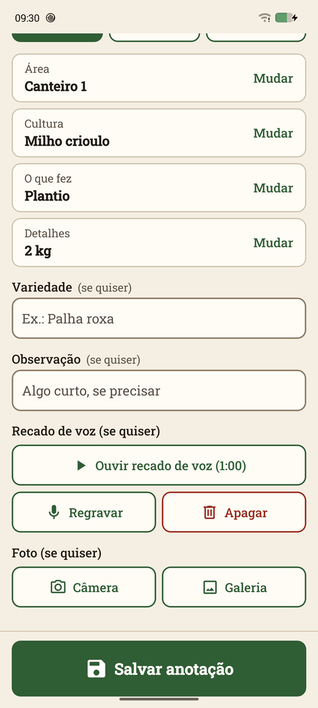
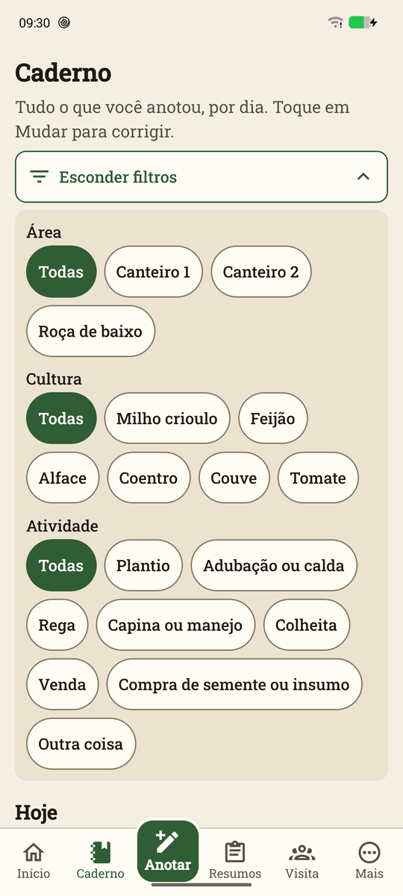
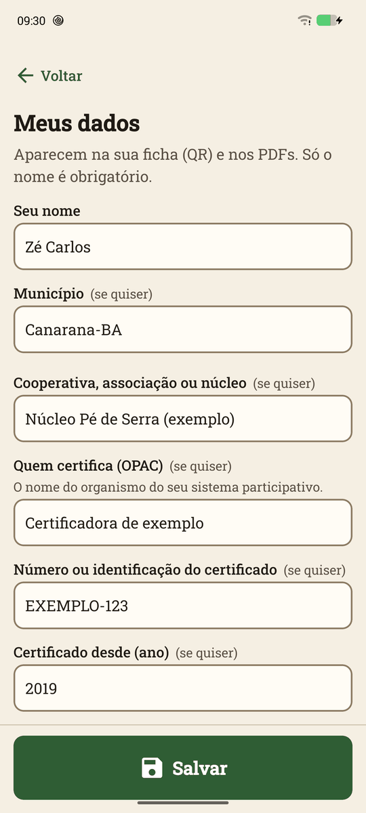
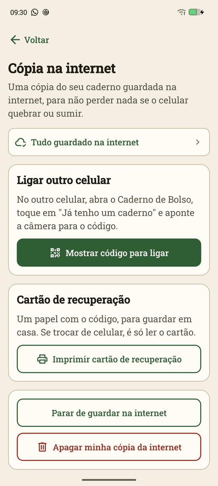
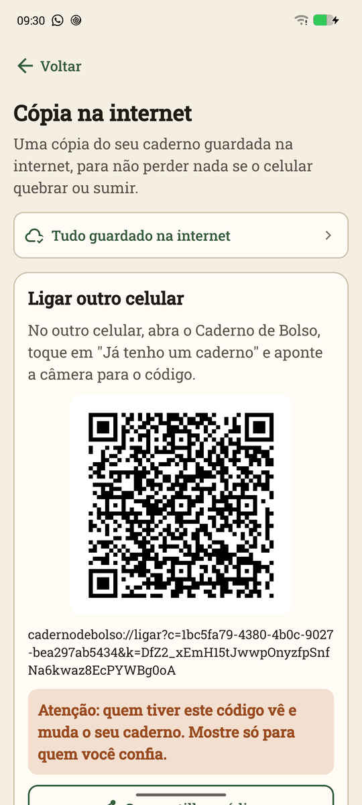
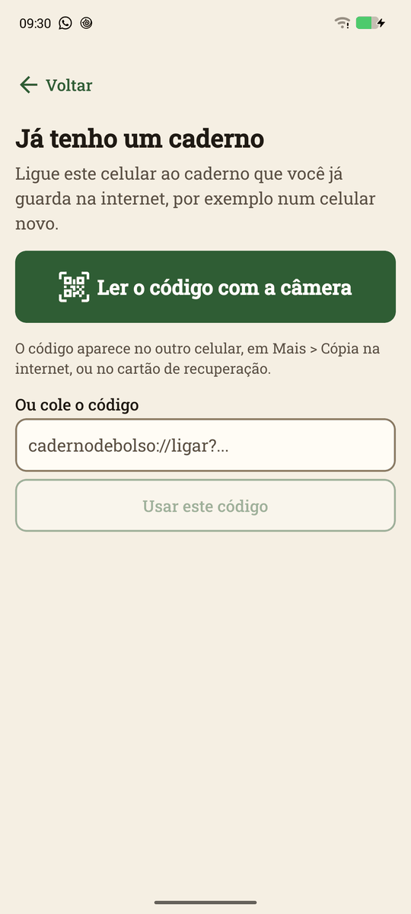

# Telas

As 31 telas do aplicativo, numeradas na ordem em que a pessoa encontra cada uma. O nome do arquivo segue o mesmo número. As capturas foram tiradas num celular Android com o app instalado, usando produtores fictícios (os dados de exemplo do próprio app e um cadastro de teste). O passo a passo completo está em [fluxos.md](../fluxos.md).

| Parte | Telas |
| --- | --- |
| [Primeiro uso](#primeiro-uso) | 01 a 05 |
| [Início](#início) | 06 a 07 |
| [Anotar](#anotar) | 08 a 15 |
| [Caderno, resumos e colheita](#caderno-resumos-e-colheita) | 16 a 19 |
| [Visita de pares](#visita-de-pares) | 20 |
| [Mais](#mais) | 21 a 28 |
| [Ligar um celular a um caderno que já existe](#ligar-um-celular-a-um-caderno-que-já-existe) | 29 a 30 |
| [Outras](#outras) | 31 |

## Primeiro uso

Aparece só na primeira vez que o app é aberto.

<table>
  <tr>
    <td align="center" valign="top"> <b>01</b> · Boas-vindas</td>
    <td align="center" valign="top"> <b>02</b> · Passo 1: Quem é você?</td>
    <td align="center" valign="top"> <b>03</b> · Passo 2: Sua certificação</td>
    <td align="center" valign="top"> <b>04</b> · Passo 3: Sua roça</td>
  </tr>
  <tr>
    <td align="center" valign="top"> <b>05</b> · Guardar uma cópia na internet?</td>
  </tr>
</table>

| Nº | Tela | Como chegar | O que faz |
| --- | --- | --- | --- |
| 01 | **Boas-vindas** | Abrir o app pela primeira vez | Explica o app em três frases. Daqui dá para começar, ver com dados de exemplo ou ligar um caderno que já existe. |
| 02 | **Passo 1: Quem é você?** | Tocar em Começar | Nome e município do produtor. |
| 03 | **Passo 2: Sua certificação** | Avançar do passo 1 | Cooperativa ou núcleo e dados da certificação participativa. Tudo opcional. |
| 04 | **Passo 3: Sua roça** | Avançar do passo 2 | Áreas e culturas que vão aparecer na hora de anotar. |
| 05 | **Guardar uma cópia na internet?** | Terminar o passo 3 | Pergunta única, sem e-mail nem senha. Quem recusa continua usando o app só no celular. |

## Início

Primeira aba. É onde o app abre no dia a dia.

<table>
  <tr>
    <td align="center" valign="top"> <b>06</b> · Início</td>
    <td align="center" valign="top"> <b>07</b> · Início com a cópia ligada</td>
  </tr>
</table>

| Nº | Tela | Como chegar | O que faz |
| --- | --- | --- | --- |
| 06 | **Início** | Abrir o app | Resumo da semana, atalho grande para anotar e o indicador da cópia na internet. |
| 07 | **Início com a cópia ligada** | Abrir o app com a cópia na internet aceita | O indicador mostra "Tudo guardado na internet". |

## Anotar

Passo a passo de uma anotação, uma escolha por tela. Abre pelo botão Anotar da barra de baixo.

<table>
  <tr>
    <td align="center" valign="top"> <b>08</b> · Onde foi?</td>
    <td align="center" valign="top"> <b>09</b> · Qual cultura?</td>
    <td align="center" valign="top"> <b>10</b> · O que você fez?</td>
    <td align="center" valign="top"> <b>11</b> · De onde veio a semente?</td>
  </tr>
  <tr>
    <td align="center" valign="top"> <b>12</b> · Quanto?</td>
    <td align="center" valign="top"> <b>13</b> · Confira e salve</td>
    <td align="center" valign="top"> <b>14</b> · Confira e salve: recado de voz e foto</td>
    <td align="center" valign="top"> <b>15</b> · Anotado!</td>
  </tr>
</table>

| Nº | Tela | Como chegar | O que faz |
| --- | --- | --- | --- |
| 08 | **Onde foi?** | Tocar em Anotar | Escolha da área. O app lembra a última usada. |
| 09 | **Qual cultura?** | Escolher a área | Culturas da roça, com as mais usadas no topo. |
| 10 | **O que você fez?** | Escolher a cultura | Plantio, adubação ou calda, rega, capina, colheita, venda, compra ou outra. |
| 11 | **De onde veio a semente?** | Escolher Plantio | Detalhe que só aparece para a atividade escolhida. Aqui, a origem da semente. |
| 12 | **Quanto?** | Avançar dos detalhes | Teclado numérico grande do próprio app e a unidade. |
| 13 | **Confira e salve** | Informar a quantidade | A anotação em uma frase, com data e observação. |
| 14 | **Confira e salve: recado de voz e foto** | Rolar a tela de revisão | Recado de até 60 segundos, que dá para ouvir, regravar e apagar antes de salvar, e a foto pela câmera ou galeria. |
| 15 | **Anotado!** | Tocar em Salvar | Confirmação, com o botão Desfazer e o atalho para anotar outra. |

## Caderno, resumos e colheita

O que o app devolve a partir das anotações.

<table>
  <tr>
    <td align="center" valign="top"> <b>16</b> · Caderno</td>
    <td align="center" valign="top"> <b>17</b> · Filtros do caderno</td>
    <td align="center" valign="top"> <b>18</b> · Resumos</td>
    <td align="center" valign="top"> <b>19</b> · Colheita e venda</td>
  </tr>
</table>

| Nº | Tela | Como chegar | O que faz |
| --- | --- | --- | --- |
| 16 | **Caderno** | Aba Caderno | Histórico por dia. Tocar numa anotação abre para ouvir o recado, editar ou apagar. |
| 17 | **Filtros do caderno** | Tocar em Filtrar, no Caderno | Filtra por área, cultura e atividade. |
| 18 | **Resumos** | Aba Resumos | Semana ou mês na ordem do caderno de campo, com a caixa "Passei para o caderno" e o PDF. |
| 19 | **Colheita e venda** | Cartão Colheita e venda, em Resumos, ou pelo Mais | Por cultura: quanto colheu, vendeu, recebeu e o que sobrou. |

## Visita de pares

Apoio para a visita. Não substitui o roteiro do grupo.

<table>
  <tr>
    <td align="center" valign="top"> <b>20</b> · Pronto para a visita</td>
  </tr>
</table>

| Nº | Tela | Como chegar | O que faz |
| --- | --- | --- | --- |
| 20 | **Pronto para a visita** | Aba Visita | Itens conferidos sozinhos a partir das anotações, itens que o produtor marca e o PDF para a visita. |

## Mais

Última aba. Reúne cadastro, ficha e cópias.

<table>
  <tr>
    <td align="center" valign="top"> <b>21</b> · Mais</td>
    <td align="center" valign="top"> <b>22</b> · Meus dados</td>
    <td align="center" valign="top"> <b>23</b> · Áreas e culturas</td>
    <td align="center" valign="top"> <b>24</b> · Minha ficha (QR)</td>
  </tr>
  <tr>
    <td align="center" valign="top"> <b>25</b> · Cópia de segurança</td>
    <td align="center" valign="top"> <b>26</b> · Cópia na internet</td>
    <td align="center" valign="top"> <b>27</b> · Código para ligar outro celular</td>
    <td align="center" valign="top"> <b>28</b> · Sobre o app</td>
  </tr>
</table>

| Nº | Tela | Como chegar | O que faz |
| --- | --- | --- | --- |
| 21 | **Mais** | Aba Mais | Menu com Meus dados, Áreas e culturas, Minha ficha, Cópia na internet, Cópia de segurança, Colheita e venda e Sobre. No fim da tela fica o tamanho da letra. |
| 22 | **Meus dados** | Mais → Meus dados | Os mesmos dados do cadastro, para corrigir quando precisar. |
| 23 | **Áreas e culturas** | Mais → Áreas e culturas | Incluir, renomear e tirar áreas e culturas. |
| 24 | **Minha ficha (QR)** | Mais → Minha ficha | QR para o comprador ler, link para compartilhar e cartão em PDF. |
| 25 | **Cópia de segurança** | Mais → Cópia de segurança | Fotos das páginas do caderno de papel e exportar ou importar tudo num arquivo. |
| 26 | **Cópia na internet** | Mais → Cópia na internet, ou tocar no indicador do Início | Situação do envio, ligar outro celular, cartão de recuperação para imprimir, parar de guardar e apagar a cópia. |
| 27 | **Código para ligar outro celular** | Cópia na internet → Mostrar código para ligar | QR e código em texto que levam o mesmo caderno para outro aparelho, com o aviso de só mostrar para quem confia. |
| 28 | **Sobre o app** | Mais → Sobre | O que o app é e o que ele não faz. |

## Ligar um celular a um caderno que já existe

Para celular novo ou segundo aparelho.

<table>
  <tr>
    <td align="center" valign="top"> <b>29</b> · Já tenho um caderno</td>
    <td align="center" valign="top"> <b>30</b> · Ligar este celular?</td>
  </tr>
</table>

| Nº | Tela | Como chegar | O que faz |
| --- | --- | --- | --- |
| 29 | **Já tenho um caderno** | Boas-vindas → Já tenho um caderno | Ler o código com a câmera ou colar o código no campo. |
| 30 | **Ligar este celular?** | Ler o QR ou colar um código válido | Confirmação antes de baixar o caderno para este aparelho. |

## Outras

<table>
  <tr>
    <td align="center" valign="top"> <b>31</b> · Página não encontrada</td>
  </tr>
</table>

| Nº | Tela | Como chegar | O que faz |
| --- | --- | --- | --- |
| 31 | **Página não encontrada** | Abrir um endereço que não existe | Aviso simples com o caminho de volta para o Início. |
