# Telas

As 31 capturas do aplicativo, numeradas na ordem em que a pessoa encontra cada tela. O nome do arquivo segue o mesmo número. O passo a passo completo de cada tela está em [fluxos.md](../fluxos.md).

| Parte | Telas |
| --- | --- |
| Primeiro uso | 01 a 05 |
| Início | 06 a 07 |
| Anotar | 08 a 15 |
| Caderno, resumos e colheita | 16 a 19 |
| Visita de pares | 20 |
| Mais | 21 a 28 |
| Ligar um celular a um caderno que já existe | 29 a 30 |
| Outras | 31 |

## Primeiro uso

Aparece só na primeira vez que o app é aberto.

| Nº | Tela | Como chegar | O que faz | Captura |
| --- | --- | --- | --- | --- |
| 01 | **Boas-vindas** | Abrir o app pela primeira vez | Explica o app em três frases. Daqui dá para começar, ver com dados de exemplo ou ligar um caderno que já existe. | <a href="01-boas-vindas.png">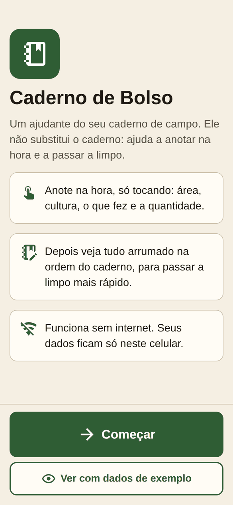</a> |
| 02 | **Passo 1: Quem é você?** | Tocar em Começar | Nome e município do produtor. | <a href="02-cadastro-nome.png">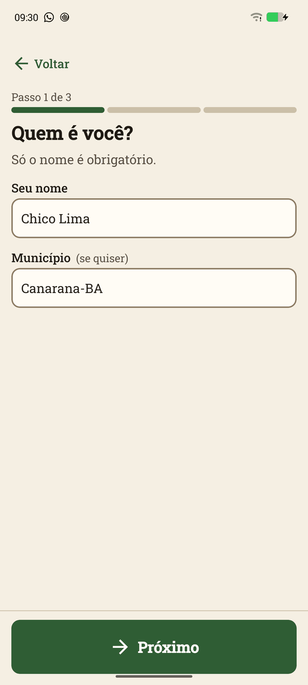</a> |
| 03 | **Passo 2: Sua certificação** | Avançar do passo 1 | Cooperativa ou núcleo e dados da certificação participativa. Tudo opcional. | <a href="03-cadastro-certificacao.png">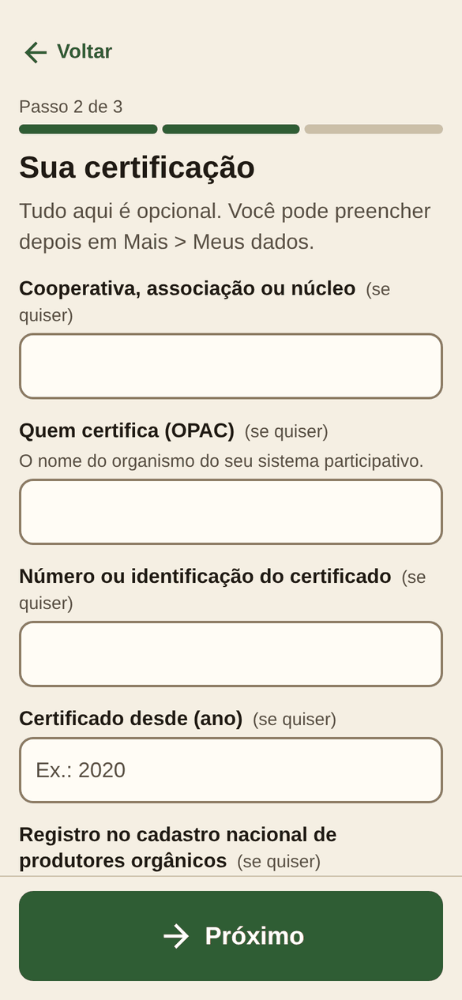</a> |
| 04 | **Passo 3: Sua roça** | Avançar do passo 2 | Áreas e culturas que vão aparecer na hora de anotar. | <a href="04-cadastro-roca.png">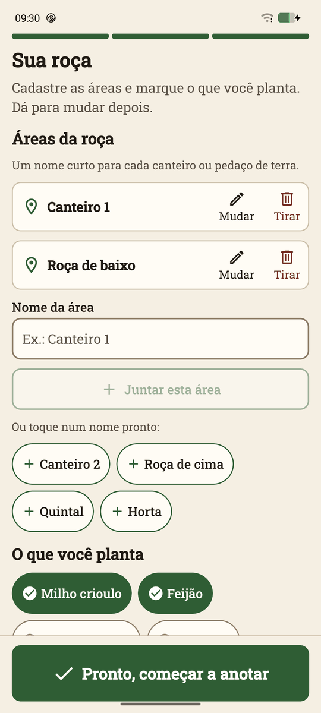</a> |
| 05 | **Guardar uma cópia na internet?** | Terminar o passo 3 | Pergunta única, sem e-mail nem senha. Quem recusa continua usando o app só no celular. | <a href="05-cadastro-copia-internet.png">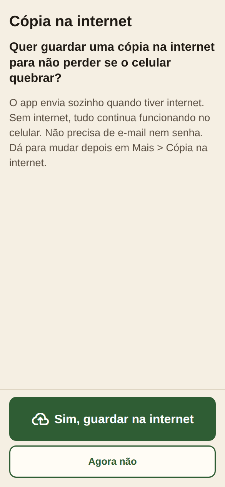</a> |

## Início

Primeira aba. É onde o app abre no dia a dia.

| Nº | Tela | Como chegar | O que faz | Captura |
| --- | --- | --- | --- | --- |
| 06 | **Início** | Abrir o app | Resumo da semana, atalho grande para anotar e o indicador da cópia na internet. | <a href="06-inicio.png">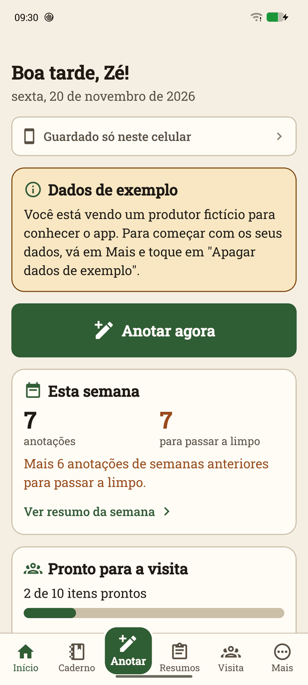</a> |
| 07 | **Início com a cópia ligada** | Abrir o app com a cópia na internet aceita | O indicador mostra "Tudo guardado na internet". | <a href="07-inicio-copia-ligada.png">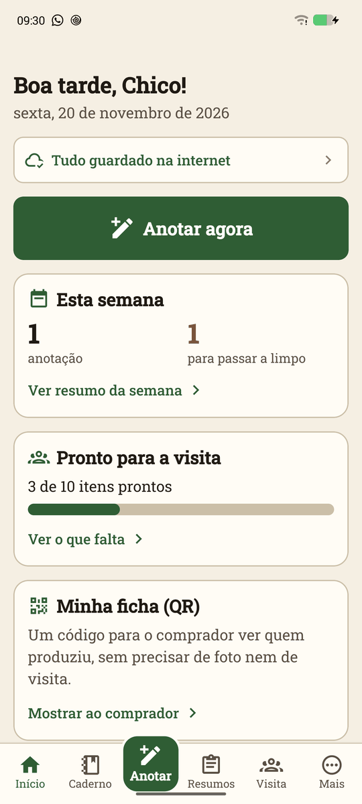</a> |

## Anotar

Passo a passo de uma anotação, uma escolha por tela. Abre pelo botão Anotar da barra de baixo.

| Nº | Tela | Como chegar | O que faz | Captura |
| --- | --- | --- | --- | --- |
| 08 | **Onde foi?** | Tocar em Anotar | Escolha da área. O app lembra a última usada. | <a href="08-anotar-1-area.png">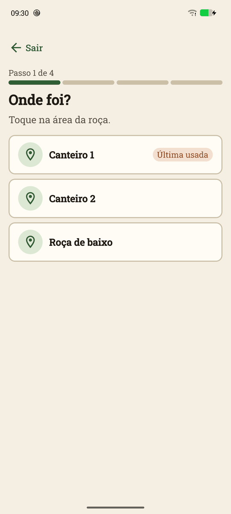</a> |
| 09 | **Qual cultura?** | Escolher a área | Culturas da roça, com as mais usadas no topo. |  |
| 10 | **O que você fez?** | Escolher a cultura | Plantio, adubação ou calda, rega, capina, colheita, venda, compra ou outra. | <a href="10-anotar-3-atividade.png">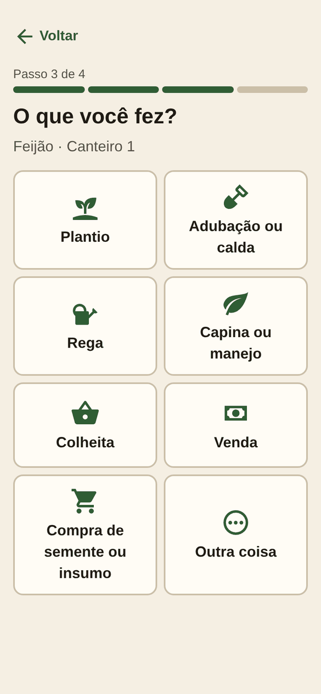</a> |
| 11 | **De onde veio a semente?** | Escolher Plantio | Detalhe que só aparece para a atividade escolhida. Aqui, a origem da semente. | <a href="11-anotar-4-origem-semente.png">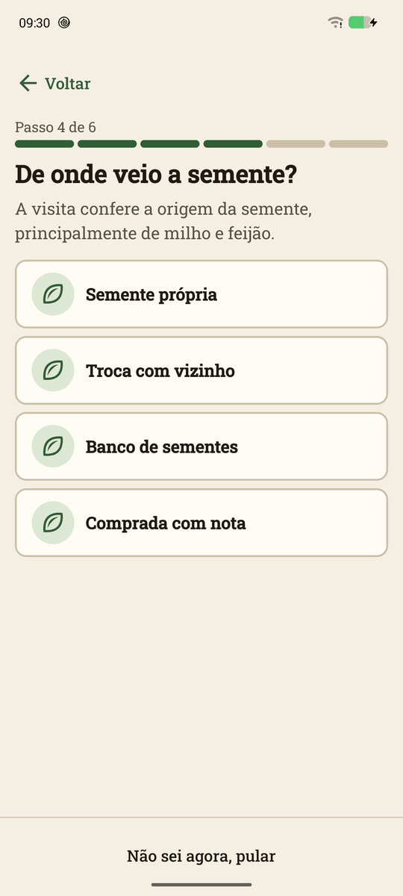</a> |
| 12 | **Quanto?** | Avançar dos detalhes | Teclado numérico grande do próprio app e a unidade. | <a href="12-anotar-5-quantidade.png">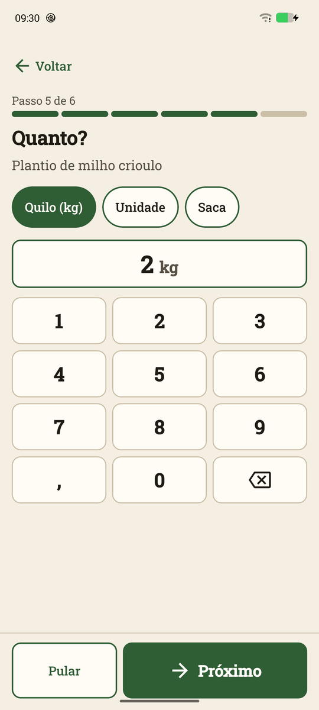</a> |
| 13 | **Confira e salve** | Informar a quantidade | A anotação em uma frase, com data e observação. | <a href="13-anotar-6-revisao.png">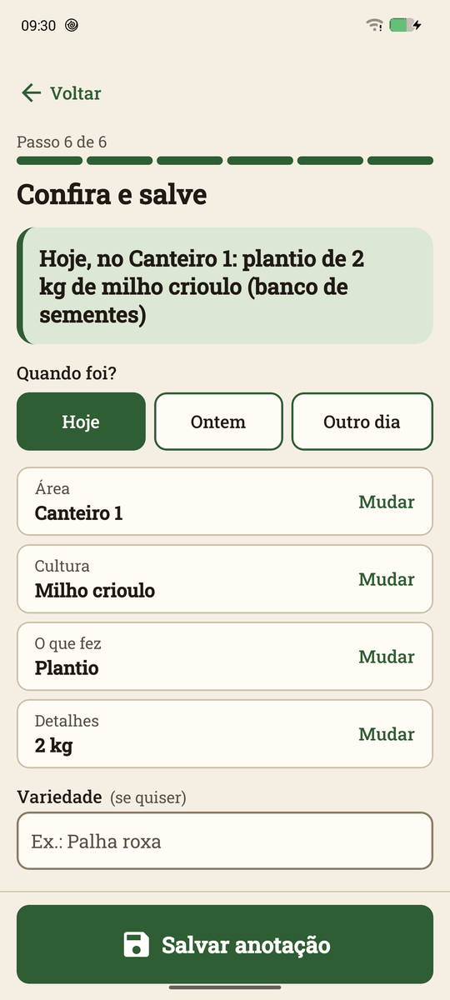</a> |
| 14 | **Confira e salve: recado de voz e foto** | Rolar a tela de revisão | Gravar um recado de até 60 segundos e juntar uma foto. |  |
| 15 | **Anotado!** | Tocar em Salvar | Confirmação, com o botão Desfazer e o atalho para anotar outra. | <a href="15-anotar-8-anotado.png">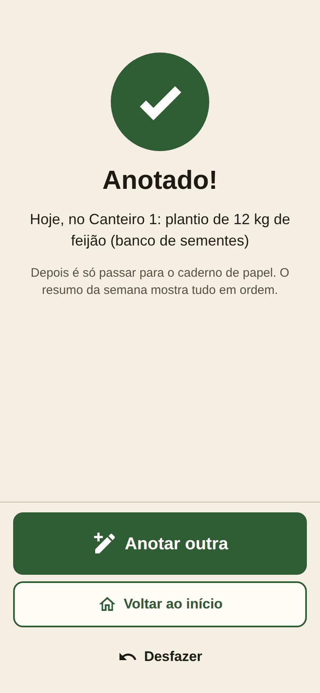</a> |

## Caderno, resumos e colheita

O que o app devolve a partir das anotações.

| Nº | Tela | Como chegar | O que faz | Captura |
| --- | --- | --- | --- | --- |
| 16 | **Caderno** | Aba Caderno | Histórico por dia. Tocar numa anotação abre para ouvir o recado, editar ou apagar. | <a href="16-caderno.png">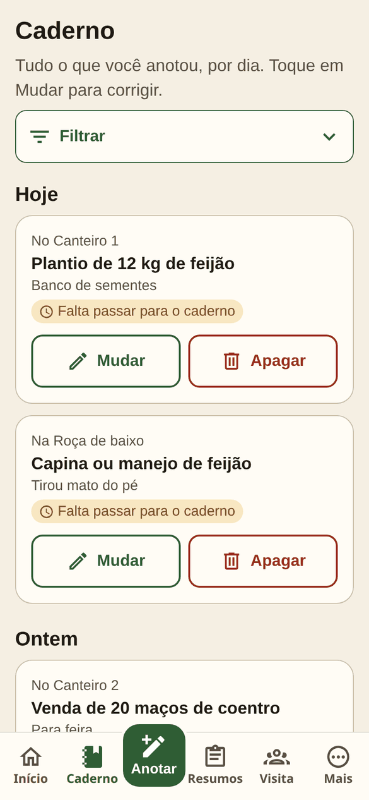</a> |
| 17 | **Filtros do caderno** | Tocar em Filtrar, no Caderno | Filtra por área, cultura e atividade. |  |
| 18 | **Resumos** | Aba Resumos | Semana ou mês na ordem do caderno de campo, com a caixa "Passei para o caderno" e o PDF. | <a href="18-resumos.png">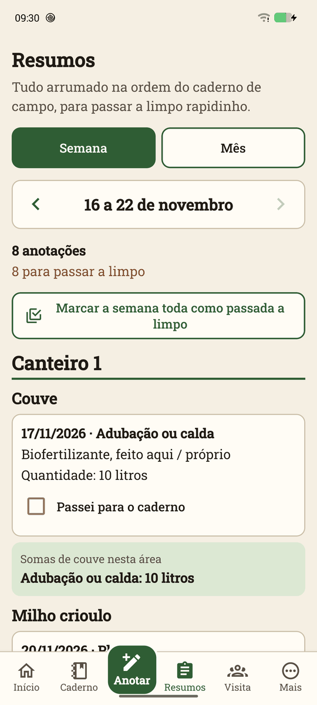</a> |
| 19 | **Colheita e venda** | Cartão Colheita e venda, em Resumos, ou pelo Mais | Por cultura: quanto colheu, vendeu, recebeu e o que sobrou. | <a href="19-colheita-venda.png">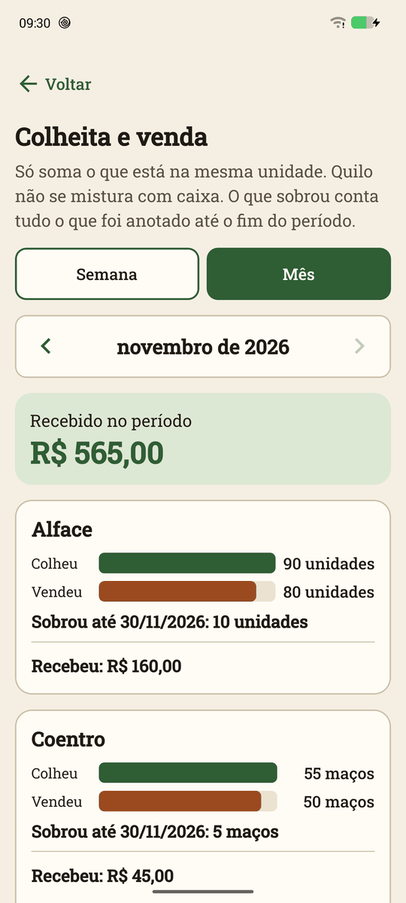</a> |

## Visita de pares

Apoio para a visita. Não substitui o roteiro do grupo.

| Nº | Tela | Como chegar | O que faz | Captura |
| --- | --- | --- | --- | --- |
| 20 | **Pronto para a visita** | Aba Visita | Itens conferidos sozinhos a partir das anotações, itens que o produtor marca e o PDF para a visita. | <a href="20-visita.png">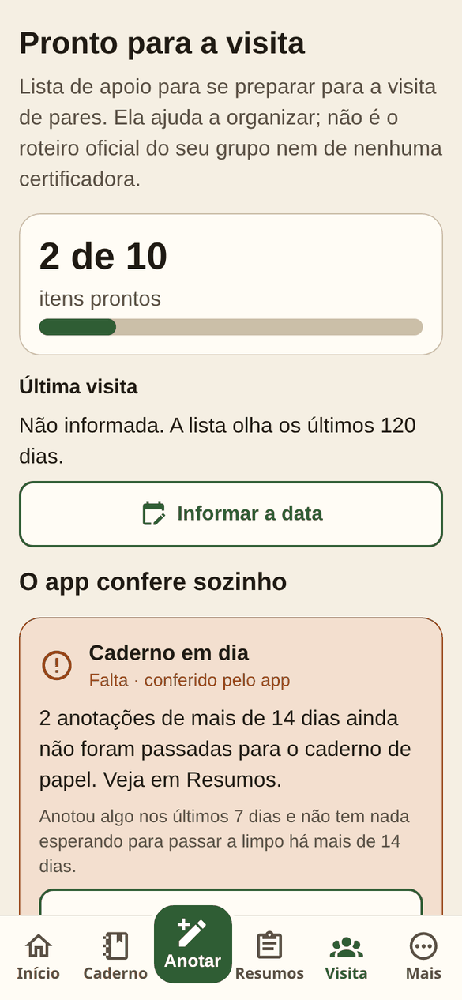</a> |

## Mais

Última aba. Reúne cadastro, ficha e cópias.

| Nº | Tela | Como chegar | O que faz | Captura |
| --- | --- | --- | --- | --- |
| 21 | **Mais** | Aba Mais | Menu com Meus dados, Áreas e culturas, Minha ficha, Cópia na internet, Cópia de segurança, Colheita e venda e Sobre. | <a href="21-mais.png">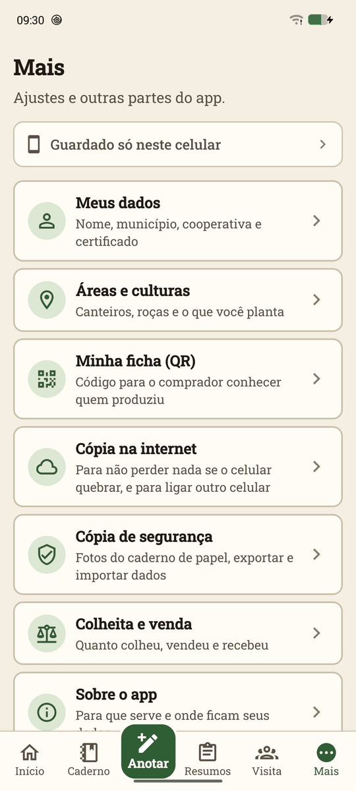</a> |
| 22 | **Meus dados** | Mais → Meus dados | Os mesmos dados do cadastro, para corrigir quando precisar. |  |
| 23 | **Áreas e culturas** | Mais → Áreas e culturas | Incluir, renomear e tirar áreas e culturas. | <a href="23-areas-e-culturas.png">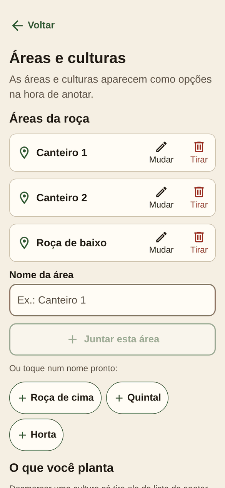</a> |
| 24 | **Minha ficha (QR)** | Mais → Minha ficha | QR para o comprador ler, link para compartilhar e cartão em PDF. | <a href="24-minha-ficha-qr.png">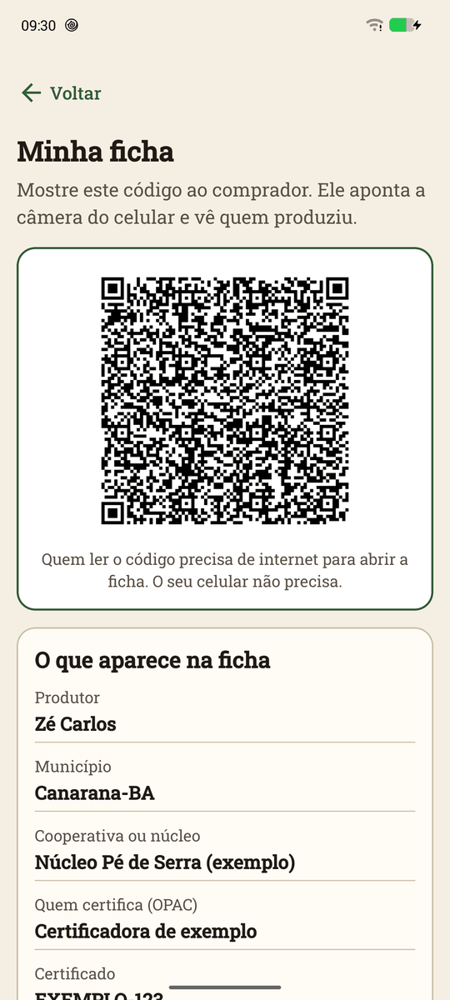</a> |
| 25 | **Cópia de segurança** | Mais → Cópia de segurança | Fotos das páginas do caderno de papel e exportar ou importar tudo num arquivo. | <a href="25-copia-de-seguranca.png">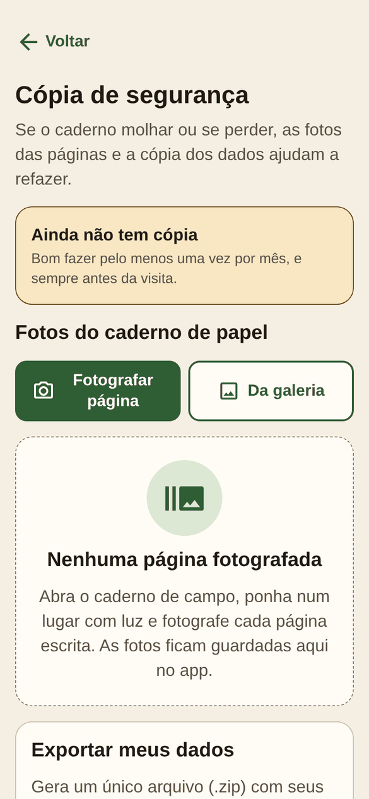</a> |
| 26 | **Cópia na internet: ligar outro celular** | Mais → Cópia na internet | Situação do envio e o QR (ou código) que leva o caderno para outro aparelho. | <a href="26-copia-na-internet-ligar-outro-celular.png">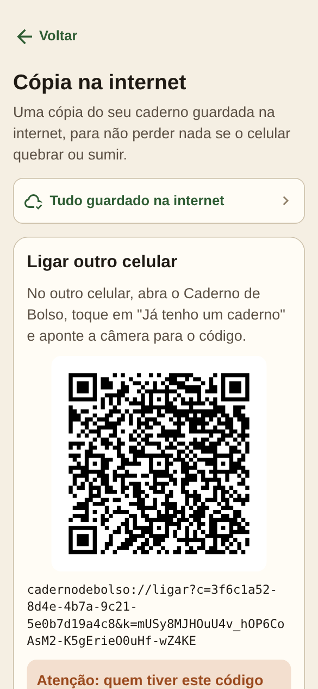</a> |
| 27 | **Cópia na internet: cartão, parar e apagar** | Rolar a tela Cópia na internet | Cartão de recuperação para imprimir, parar de guardar e apagar a cópia. | <a href="27-copia-na-internet-cartao-e-apagar.png">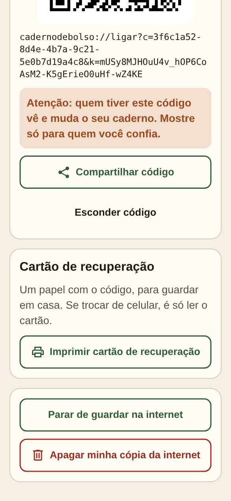</a> |
| 28 | **Sobre o app** | Mais → Sobre | O que o app é e o que ele não faz. | <a href="28-sobre.png">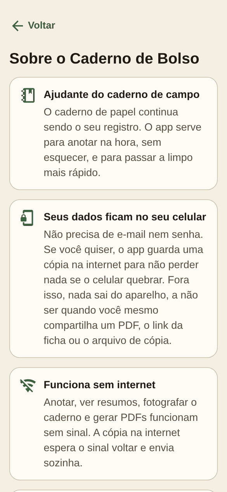</a> |

## Ligar um celular a um caderno que já existe

Para celular novo ou segundo aparelho.

| Nº | Tela | Como chegar | O que faz | Captura |
| --- | --- | --- | --- | --- |
| 29 | **Já tenho um caderno** | Boas-vindas → Já tenho um caderno | Ler o código com a câmera ou colar o código no campo. |  |
| 30 | **Ligar este celular?** | Ler o QR ou colar um código válido | Confirmação antes de baixar o caderno para este aparelho. | <a href="30-ja-tenho-um-caderno-confirmar.png">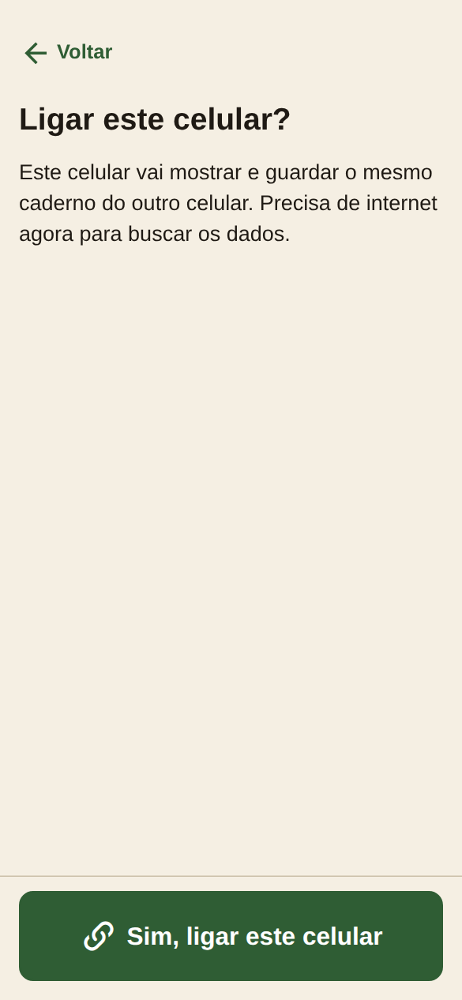</a> |

## Outras

| Nº | Tela | Como chegar | O que faz | Captura |
| --- | --- | --- | --- | --- |
| 31 | **Página não encontrada** | Abrir um endereço que não existe | Aviso simples com o caminho de volta para o Início. | <a href="31-pagina-nao-encontrada.png">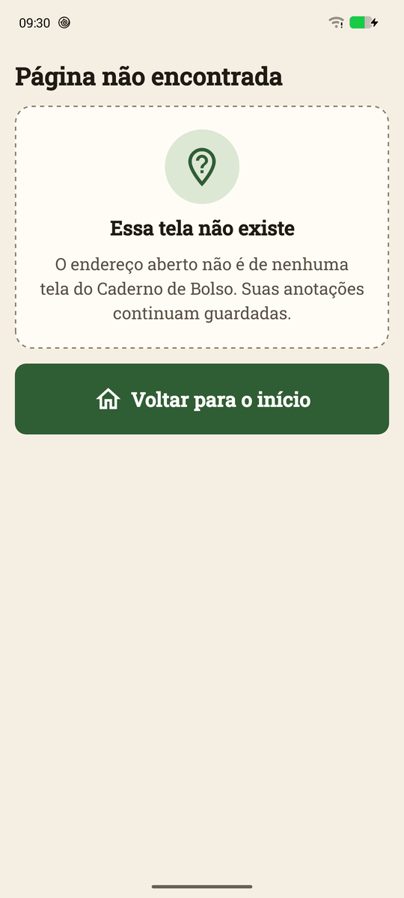</a> |
